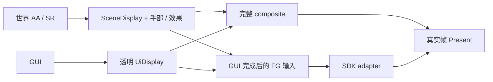

# 帧生成与 Reflex 设计说明

本文讲 Illusion（mod id `dxr_mc`）里「帧生成（frame generation）」与「Reflex」两个子系统的设计：它们要解决什么、一帧的时间线上各自插在哪里、JVM 与 native 怎么分工、哪些约束不能动。内容全部来自源码、注释与实现；代码里没有明确写出来的标「代码中未明确」。

阅读顺序建议：先读 §1（概念）与 §2.2（一帧的时序），再按需查 §5（常量）、§6（不变量）。

## 1. 概念

### 1.1 帧生成在做什么

帧生成不是「提高渲染帧率」，而是在**两次真实提交之间插入由 GPU 生成的中间帧**。游戏逻辑、渲染、超分仍按原来的节奏跑；被改变的是**呈现到屏幕上的帧数**。因此：真实渲染帧数 = `rendered fps`（F3 行左边那个数字），屏幕上看到的帧数 = `output fps = rendered fps × 倍率`（斜杠右边的数字）。

倍率 = 1 + 每次提交插入的帧数。`numFrames = 1` 是 2×，`numFrames = 5` 是 6×。

帧生成**不降低延迟**，反而会增加延迟（多出来的帧让 present 排队变深）。所以它与低延迟技术是绑定关系而不是并列关系——见 §3.4。

### 1.2 三家后端的形态差异

三个后端在「谁接管交换链」「需要哪些输入」「能插几张」上完全不同，这是设计里所有分支的根源：

| | DLSS-G | FSR-FG | XeSS-FG |
| --- | --- | --- | --- |
| 接管方式 | Streamline 代理（`sl.dlss_g`） | 自己包 `IDXGISwapChain` | 自己包 `IDXGISwapChain` |
| 链归属常量 | `SL_PROXY` | `FSR_WRAP` | `XESS_WRAP` |
| 场景输入 | 最终 SceneDisplay | 最终 SceneDisplay | 最终 SceneDisplay |
| UI 输入 | 独立 UiDisplay 标签 | 独立 UiDisplay 合成 | 独立 UiDisplay 标签 |
| 深度 / 运动矢量 | 显示工作图输出 | 显示工作图输出 | 显示工作图输出，完整 tuple dilation |
| 相机常量 | native 翻译显示相机，viewport1 | native 翻译显示相机 | native 翻译显示相机（行主序） |
| 低延迟依赖 | Reflex（`needsReflex = 1`） | Anti-Lag 2（预留） | XeLL |
| 每提交最多插几张 | 5 | 1（只有 2×） | 由 SDK 报，镜像到上限 |
| 运行库在发行包里 | 否 | 否 | 是 |

三家共用同一份最终场景、显示尺寸 guides 与 UI；交换链的 UI 合成规则由各 adapter 按 SDK 契约实现。

### 1.3 为什么需要 hudless UI

如果把 HUD（准星、血条、文字、物品栏）一起烘进世界层再交给插帧后端，后端会把 HUD 当成「世界内容」按运动矢量插值：准星被拉扯、文字发糊、快捷栏跟着视角一起「游」。UI 本来应该是每帧都清晰、且不该被插值的东西。

显示过程保留三张窗口尺寸纹理：SceneDisplay 包含重建后的世界、第一人称手部及晚期效果，UiDisplay 从透明底绘制 GUI，composite 保存二者合成结果。



FSR 的 scene-only Present 需要当帧 UI 注册成功。DLSS-G、XeSS-FG 仍使用各自的呈现与 UI 标签契约。每帧保持完整 composite，readiness 失败或本帧跳过 FG 时选择它，避免丢失界面。世界重建的输出目标固定为 SceneDisplay，UI 决策无需改变已经完成的 SR。

### 1.4 UI 纹理契约

交出去的是 GUI 自己那张**窗口尺寸**的目标（`D3D12GUIRenderTarget`），契约有四条：

1. **句柄**：传的是 `Dx12Object*`（`D3D12GpuTexture.handle()`），native 侧解包成 `ID3D12Resource*`；传 `0` 表示撤销注册。
2. **推送时机**：只在 GUI 目标创建/重建时推一次，不是每帧；句柄没变就不重推。目标消失（窗口重建、renderScale 变化）必须重推或撤销，否则后端会拿着一张已经释放的纹理。
3. **尺寸**：必须是窗口像素尺寸，与呈现源同尺寸——SDK 把「UI 纹理」理解成最终输出分辨率。
4. **内容**：`RGBA8`，从**全透明**开始画。原版 `BlendFunction.TRANSLUCENT` 的 alpha 通道是 `ONE / INV_SRC_ALPHA`，所以「透明底 + 普通混合」得到的结果正好是「RGB 按自身 alpha 预乘 + alpha 是覆盖度」，对应 FidelityFX 的 `USE_PREMUL_ALPHA` 合成约定。

配套的开关语义：`setUiComposition(1)` 请求 FSR 对本次 scene-only Present 合成 UI；`0` 使用完整 composite。GUI 完成后准备请求，晚期 DisplayFrame 接受后再次确认当帧 readiness，JVM 的 latch 与 native 同步。准备失败、本帧未被 SDK 接受或 GUI 已包含模糊场景背景时关闭 scene-only 呈现。菜单和加载帧显示完整 GUI。

UiDisplay 清理前必须完成上一帧 Present 与 SDK 源读取等待。工作图对最终像素的 depth/MV/validity/provenance 作统一变换；整层或像素运动缺失、未知 post 映射、GUI 已含场景时跳过本帧 FG，真实帧继续呈现。

### 1.5 为什么有些后端不可用（发行包只带 XeSS 运行库）

运行库按许可证分成两类，这是「为什么发行版里 DLSS-G / FSR-FG 永远是灰的」的直接原因：

- **随发行包走**（JAR 的 `vendor/` → 启动时解到 `dxrmc/`）：`libxess.dll` / `libxess_fg.dll` / `libxell.dll`（Intel 允许再分发，条件是版权与条款随发行物走），以及图形管线硬性依赖的 `D3D12Core.dll`（Agility SDK）与 `dxcompiler.dll` / `dxil.dll`（DXC）。
- **只进开发目录**（`run\dxrmc\`，由 `copyVendorDlls` 复制）：`nvngx_*.dll`（DLSS 运行时）、`sl.*.dll`（Streamline 插件，Reflex 与 DLSS-G 都靠它）、`NvLowLatencyVk.dll`、`amd_fidelityfx_*.dll`（FSR 运行时）。NVIDIA 的许可不允许以会让 SDK 受开源许可约束的方式再分发；AMD 侧自某个版本起也不再进发行包。
- 一次性测试包 `jarALL` 会把上面这些也塞进 `vendor/`，只用于测试、不可分发。

所以发行版的真实情况是：`available = 0`，`note` 说明原因（`DLSS runtime not loaded` / `not on the Streamline path` / `fsr-fg runtime missing` …）。界面不会因此崩溃，只会显示「不可用」和理由。Reflex 同样来自 Streamline，所以发行版里 Reflex 也报不可用，DLSS-G 的「需要 Reflex」条件也就永远不成立。

### 1.6 能力表是唯一事实来源

每个后端的 `available / runtimeLoaded / deviceSupported / chainCompatible / needsReflex / needsUiResource / needsHudless / transitionsInputs / maxGeneratedFrames / chainOwner / latencyProvider / note` 都由 native 的 `fillCaps` 填，JVM 只读不猜。

- JVM 侧 1 秒 TTL 缓存整套能力表，`push()` 时再作废一次；不每帧查的原因是跨 ABI 调用。
- 不能用「有 D3D12 适配器」推断「帧生成可用」：运行库加载、设备特性、链能不能包，是三件独立的事。
- `chainCompatible` 必须按**将要建的链**判断。否则从 Streamline 代理链启动的用户点开 FSR-FG 后永远建不出 provider——它一直认为自己「链不兼容」，表现就是点了开关什么都不发生。

## 2. 架构与数据流

帧生成配置遵循 [`../rendering/render-configuration.md`](../rendering/render-configuration.md)：FG Prepare 与 SR Prepare 先分别形成候选，组合 Commit 成功后才发布世界附件和 UI 状态。同尺寸准备失败保留原 applied；resize 尚未 ready 时先发布新尺寸的临时 NONE/FG OFF 配置，同尺寸 SDK 拒绝后暂停自动重试。完整 Published 更新 persistent，save 通过 settingsToSave 读取它，临时配置不覆盖保存值。

### 2.1 分层

```
JVM（策略层，io.github.dxegp）
  render/presentation/framegen/FrameGeneration.kt            ← 选项、配置请求、持久化与状态展示
  render/presentation/latency/NvidiaReflex.kt          ← Reflex 模式 + 被帧生成强制开启的策略
  render/presentation/D3D12SceneDisplay.kt ← 重建输出与晚期场景
  render/presentation/D3D12GUISplit.kt  ← UiDisplay / composite 与当帧 UI 合成
  render/presentation/display/         ← DisplayFrameInputs 冻结、guides Prepare 与晚期 Submit
  d3d12/surface/D3D12GpuSurface.kt         ← present：调 native、帧计数、裁决挂点
  d3d12/ffi/MCDR_ABI.kt + MCDR_Layout.kt   ← FFM 绑定与结构体布局（唯一 native 入口）
        │  FG Prepare / SR Prepare / Commit / fgQueryCaps / fgState / fgSetUiTexture /
        │  fgSetUiComposition / fgUiCompositionReady / beginDisplayFrame / prepareDisplayFrame / submitDisplayFrame
        ▼
native（MCDR，C++23 模块）
  src/render/presentation/d3d12_framegen.cpp  ← 注册表（picked/applied/chainOwner）、门面、回滚判定
  src/render/presentation/d3d12_display_frame.cpp ← 显示 guides 工作图与有效性判定
  src/render/reconstruction/d3d12_dlss.cpp      ← DLSS-G provider（真正的 slDLSSGSetOptions 在这里下发）
  src/render/presentation/d3d12_fsffg.cpp     ← FSR-FG provider（FFX 类型只在这个单元里）
  src/render/presentation/d3d12_xessfg.cpp    ← XeSS-FG provider
  src/render/presentation/d3d12_surface.cpp       ← Present 两侧的钩子时序
```

为什么 native 的注册表在 `d3d12_framegen.cpp` 而不是各家 provider 里：注册表要在 Present 两侧挂钩、要看交换链状态、要解包 `Dx12Object`，这三件事只有 device 模块能做。provider 只管自己的 SDK。

### 2.2 一帧的时序

用户修改设置时，FrameGeneration 只向 RenderConfiguration 提交 requested。渲染线程在帧首创建 PreparedRenderConfiguration，依次 FG Prepare、SR Prepare，再组合 Commit；成功后发布世界附件、applied、Option/UI，完整 Published 再更新 persistent 与保存值。同尺寸失败保留旧配置，resize 按配置契约先确保新尺寸可渲染；要求重启的 provider 切换通过独立结果返回。

渲染线程（每帧）：

```
GameRenderer.render
 ├─ beginDisplayFrame：按已 configure 的窗口 resize 原版目标 → apply config → native display begin
 ├─ 原版后续投影上传：使用已发布尺寸/配置计算 jitter
 ├─ 世界渲染 → WorldReady → 发布 PreparedFrame → AA / SR → SceneDisplay
 ├─ 手部：独立 HUD projection、depth、motion、coverage
 ├─ screen effects / outline / post
 ├─ beforeGui：seal SceneDisplay → prepareForGui → GuiReady → PrepareDisplayFrame
 │    ├─ 冻结 scene / layers / posts / cameras，世界与手部各带独立 coverage
 │    └─ 录制 guides / validity，先提交 world + guides，保存 guideFence 并换 ring
 ├─ CPU 录制 GUI → completeGui
 ├─ afterGui：SubmitDisplayFrame 只补 UI/backdrop
 │    ├─ 核对冻结值 → 等准确 guideFence → 同帧 validity 回读
 │    └─ 有效则 adapter 接受，否则跳过本帧 FG；随后生成完整 composite
 ├─ 当帧 UI readiness → 选择 scene-only 或完整 composite
 └─ 最终 blit → command submit → Present → 按 ticket 提交或失效历史
```

provider/交换链在 display begin 准备，避免晚期重建使当帧资源失效。SDK 接受在 GUI 完成、冻结输入与同帧 validity 通过核对后发生；接受、最终提交、真实 Present 分别推进。guide 的中间提交保留同一 context 与 GuiReady，保存 fence 后换 ring 续录，不等待 guide 完成、不创建最终 Present ticket。最终异步 Present 携带不可变 `FgPresentTicket`，按 context、provider generation、frame identity 和 fence 配对，成功后提交历史。

Minecraft.renderFrame HEAD 只记录帧开始时间，之后才 window configure；窗口目标和配置在 beginDisplayFrame 内依次更新。当前构建与运行覆盖见 [实施记录](../rendering/work-graph-implementation.md#当前构建与运行)。

显示 Prepare/Submit 两阶段已接线，最终裁决仍有一次同帧 GPU→CPU 等待/回读；与 CPU GUI 录制重叠后的吞吐与延迟成本尚未测量。配置事务的 FG Prepare 与显示帧 Prepare 是两个入口：前者的 0 表示先前显示帧、录制、Present 或 provider 输入尚未退休，-3 表示 SDK 不支持或参数档位拒绝；显示帧 Prepare/Submit 的返回值、ABI11、coverage 编码和跳过条件见 [FFM ABI](../misc/ffm-abi.md)。

设备移除（device removed）时，present 的帧生成钩子直接跳过并只警告一次：这些钩子会解引用设备对象，在已失效的设备上继续走就是崩在 SDK 里。

### 2.3 三条帧号轨道

native 注册表里维护三套计数，**不能混用**：

| 轨道 | 递增点 | 用途 |
| --- | --- | --- |
| `appFrameId` | display begin / provider 帧开始 | 应用侧真实显示帧，日志对账 |
| `backendFrameId` | provider 每次把帧交给 SDK 时 | 后端侧提交序号，必须严格 +1 |
| `presentId` | `Present` 成功之后 | 真实呈现次数，回滚判定与宽限计时都基于它 |

约束：`backendFrameId` 与 `presentId` 必须**严格连续**（中间丢一个，SDK 会当作不连续而丢掉插帧或报错）；跨 resize、切后端、链重建都不复位 `presentId`。`presentSurface` 在没有东西可 present 时会提前返回，因此 `presentId` 只统计真实呈现。

### 2.4 期望值与生效值

JVM 的 requested/applied 表达配置请求与成功发布；native 的运行状态继续记录 provider 与交换链实际状态。组合 Commit 更新被接受的 FG/SR 配置，display begin 再沿 native 生命周期准备对应 provider/交换链。因此同一个状态在两侧有不同的表达：`picked` = 用户选的后端 id（`0` = 没选）；`applied` = 真正建好 provider 的后端 id；`chainOwner` = 当前交换链被谁接管（`APP_NATIVE` / `SL_PROXY` / `FSR_WRAP` / `XESS_WRAP`）；`chainMode` = 链是按「不带插帧」还是「带插帧」建的（0 / 1）。

「期望 ≠ 生效」时，能力表的 `note` 会被**替换成**失败理由，而不是继续显示静态的 `ready`。不这么做的话，用户点了开关、实际什么都没发生，界面还在说「已就绪」——界面在说假话。

包装型后端还要多看一眼链：provider 建成（`applied == picked`）不等于链已经包好。重建失败（典型原因是独占全屏）时 provider 在、链没换，只看 `applied` 就会把失败理由咽掉。所以判据是「provider 已生效 **且** 链归属已经落在期望的家族里」。

### 2.5 回滚与重建

- **宽限窗口**：期望开但还没有 provider 时，给 300 个 present（60fps 下约 5 秒）的宽限，之后才警告一次。启动早期的短暂不可用是正常现象，这时报警只会造假故障。
- **重试节奏**：建 provider / 包链失败后每 30 个 present（约 0.5 秒）重试一次。
- **回滚**：期望开、但连续 60 个 present（约 1 秒）里 `available == 0`，就 shutdown provider、把 `applied` 置 0、把 `desiredMode` 清成 0（否则 JVM 会一直以为开着，界面继续显示「开」），并且如果链是包装过的就置 `rebuildPending`，让交换链在下一帧首回到原生路径。
- **重建**：`chainMode` 与 `desiredMode` 是否跨过 0 边界不一致、或 resize、或刚才的回滚，都会置 `rebuildPending`，由主线程在下一帧首消费。链重建必须在帧首做，不能插在 Present 中途。

回滚只是「代码侧回滚」，JVM 侧的设置仍然写着「开」，所以界面必须额外显示一行回滚提示——这是 §2.4「界面不能说假话」的另一面。

### 2.6 状态字

`fgState()` 返回一个打包的 32 位整数，界面用它判断「native 其实已经回滚了」：

| 位 | 含义 |
| --- | --- |
| `[0..7]` | `desiredMode`（0 关 / 1 固定 / 2 动态），回滚时清 0 |
| `[8..15]` | `chainMode`（0 = 无插帧链，1 = 带插帧链） |
| `[16..23]` | `active`（1 = 后端真的在跑） |
| `[24..31]` | `rebuilds`（重建次数，截到 255） |

打包成整数而不是多个导出，是为了让「读一次状态」只有一个跨 ABI 调用、且天然是原子的。

### 2.7 谁决定什么

| 决定 | 在哪 | 为什么 |
| --- | --- | --- |
| 用哪个后端 | JVM（用户点开关） | 三家观感/延迟/兼容都不同，不做自动挑 |
| 能不能用 | native `fillCaps` | 只有 native 知道运行库、设备、链 |
| mode / frames 配置 | RenderConfiguration → FG Prepare/组合 Commit | 只发布已成功准备的配置 |
| 何时建链 / 包链 | native，在 display begin | 设备拥有交换链与 provider 生命周期 |
| 本帧是否 scene-only | GUI 完成、晚期提交后的 JVM/native readiness | 必须对应本帧已接受输入及 UI 注册 |
| 何时回滚 | native | 需要连续帧的可用性统计 |

「不做自动挑后端」是明确的产品决定：三条链路的画面、延迟、兼容性都不同，自动挑会把用户带进一个他自己没选过的路径，出问题时也无法解释。`selectedBackend == 0` 就是「关」。

## 3. Reflex

### 3.1 模式

`MODE_NAMES = ["off", "on", "boost"]`，下标就是送给 native 的值（`0` 关 / `1` 开 / `2` 开 + boost），对应 Streamline 的 `eOff` / `eLowLatency` / `eLowLatencyWithBoost`。默认 `on`（1）。

**下标不能重排**：它同时是 `options.txt` 里的字面量、界面下拉的顺序、native 的模式值，三者共用一个编号。

### 3.2 被帧生成强制开启

只有能力表声明 `needsReflex` 的后端强制 Reflex。RenderConfiguration 成功发布该配置后调用 `forceOn()`；关闭或切换到不要求 Reflex 的配置后调用 `releaseFrameGenerationForce()`，恢复用户偏好。准备未成功时不提前改变 Reflex 生效状态。

为什么不能只写 `OPTION.set(1)`：`Options.load()` 期间 `OptionInstance.set` 不触发回调，写了选项但 native 没收到，于是「界面显示开、实际没开」。所以强制路径必须同时写选项与 native 两处。同样的理由，`save()` 写的是 `currentMode` 而不是 `OPTION.get()`：原版在某些时机会把选项重置回默认值，信选项就会把用户的选择弄丢。

### 3.3 限帧

`[dlss] reflexFrameLimitUs`（整数微秒，范围 `0..100000`，`0` = 不限）。它经 `D3D12SetReflexFrameLimit` 推给 native，是 Reflex 侧唯一的限帧入口。

与帧生成的关系：动态倍率（`frames = 0`）下，倍率不是用户选的，而是由「目标帧时间」反推的。给了限帧就以它为目标；`0` 则交给 Streamline 的 `eDynamic` 自己决定。固定倍率时限帧只限制上限，不改变倍率。

### 3.4 为什么必须和帧生成一起用

帧生成把 present 的排队深度做深了（多插的帧要等 GPU 算完才能显示），输入延迟随之上升。Reflex 做的正是「在 present 前把 CPU 停下来等 GPU」这件事，把队列重新压平。两者单独用都成立，但「只开帧生成不开 Reflex」= 帧数变多、手感变差，是这套技术最典型的误用。

因此：DLSS-G 的 `needsReflex = 1`，Reflex 不可用时它的 `available = 0`；而 FSR-FG / XeSS-FG 的低延迟分别走 Anti-Lag 2 与 XeLL，所以它们的 `needsReflex = 0`（`latencyProvider` 分别是 `ANTILAG2` 与 `XELL`）。Anti-Lag 2 在本仓库里只有头文件、没有运行库，所以 FSR-FG 的低延迟目前是预留位；XeSS-FG 则要求 XeLL 真的能用，否则 SDK 的链初始化直接返回 `XEFG_SWAPCHAIN_RESULT_ERROR_LATENCY_REDUCTION_UNSUPPORTED`。

### 3.5 每帧调用

Reflex 每帧两个点：`before_present`（帧起点 + 限帧 sleep）与 `after_present`（渲染提交标记），此外还要发 PCL 标记（`eSimulationEnd` = 1、`eRenderSubmitStart` = 2）。

**关闭 Reflex 时这些调用仍然每帧照发**，只是 mode 是 `eOff`。官方文档明确要求：不发 sleep 与标记会让 PCL 统计断链，也会让「用户刚关掉 Reflex」的那几帧出现虚假的低延迟读数。所以 native 侧不做「关了就不调用」的短路。

### 3.6 持久化

`options.txt` 里一行 `dxrMcReflex:<off|on|boost>`。加载时按名字或数字解析，越界或无法识别就回到默认；保存时先过滤掉旧行再追加，避免出现两行。

## 4. 自动化验证边界

帧生成的运行时门面不包含自动化开关、强制后端或按 tick 改配置的测试钩子。需要验证能力表、后端切换和 provider 生命周期时，在 `src/probes/` 或独立客户端脚本中调用公开 ABI，并使用独立进程和场景日志收集结果。验证程序不得写入玩家配置，也不得从 `IllusionClient` 注册 tick 监听器。

### 4.1 失败如何降级

能力状态不改变运行时的降级策略，只是把状态暴露出来。真正的降级链是三段：`available = 0` → 门面不选它（发行版就是这一层，界面上显示原因）；建链/包链失败 → 每 30 帧重试，`note` 写失败理由；连续 60 帧不可用 → 回滚（§2.5），并在界面上显示「已回滚」。

**回滚不改 JVM 的设置**：设置仍然是「开」，用户再点一次开关才会重新尝试。这是有意的——自动改用户的设置会让「我明明开了却没了」变成另一个谜。

## 5. 关键常量与枚举

### 5.1 JVM 侧

| 常量 | 值 | 含义 |
| --- | --- | --- |
| `MIN_FRAMES` | 0 | 0 = 自动（动态倍率） |
| `MAX_FRAMES` | 5 | 与 DLSS-G 的 `numFramesToGenerateMax` 一致 |
| `DEFAULT_FRAMES` | 1 | 2× |
| `DEFAULT_MODE` | 0 | 默认关（帧生成不默认开） |
| `CAPS_TTL_NS` | 1_000_000_000 | 能力表缓存 1 秒 |
| `NOT_READY_LOG_INTERVAL_NANOS` | 10_000_000_000 | hudless 未就绪的日志节流 |
| `NvidiaReflex.DEFAULT_MODE` | 1 | Reflex 默认 `on` |
| `reflexFrameLimitUs` | 0..100000 | 微秒，0 = 不限 |

`options.txt` 的键：`dxrMcFrameGeneration`（`off` / `on`）、`dxrMcFrameGenerationFrames`（0..5）、`dxrMcFrameGenBackend`（`dlssg` / `fsrfg` / `xessfg`）、`dxrMcReflex`（`off` / `on` / `boost`）。**键名不改**：改了就等于把老用户的设置扔掉。

### 5.2 native 侧

| 常量 | 值 | 含义 |
| --- | --- | --- |
| `ENSURE_RETRY_FRAMES` | 30 | 建 provider 的重试间隔（约 0.5 秒 @60fps） |
| `USABLE_GRACE_FRAMES` | 300 | 期望开但没 provider 的宽限（约 5 秒） |
| `ROLLBACK_FRAMES` | 60 | 连续不可用的回滚阈值（约 1 秒） |
| 周期日志 | 每 600 present | `[FG]` 一行完整状态 |
| `note` 容量 | 28 字节 | 文本 ≤ 27 字符，理由串都写成短句 |
| `mcdr_fg_caps` | 80 字节 | 能力表 |
| `mcdr_fg_dispatch` | 96 字节 | 每帧分发数据 |

### 5.3 枚举

后端：`NONE 0 / DLSSG 1 / FSRFG 2 / XESSFG 3`（JVM 与 native 同值）。链归属：`APP_NATIVE 0 / SL_PROXY 1 / FSR_WRAP 2 / XESS_WRAP 3`。低延迟提供者：`NONE 0 / REFLEX 1 / ANTILAG2 2 / XELL 3`。mode：`0` 关 / `1` 固定倍率 / `2` 动态倍率（与旧 `SetDlssgMode` 同义）。

倍率的换算：`frames` 的选项值 `n ≥ 1` → 显示 `(n+1)×`，native 收到 `mode = 1, numFrames = n`；`n = 0` → 显示 `auto`，native 收到 `mode = 2, numFrames = 1`。FSR-FG 无论选项是什么都下发 `numFrames = 1`（它只插 1 张），界面对它给一行「固定 2×」的说明，而不是一个总是无效的滑条。

## 6. 不变量与硬约束

1. **一次会话只用一个「接管交换链」的后端**。链已被 FSR-FG / XeSS-FG 接管时改选别的后端会被拒绝（FG Prepare 返回需重启结果，界面显示原因）：代理链的上下文绑在旧 provider 上，热切换会让下一次 Present 走一条已经没有上下文的链（实测崩在 SDK 线程或返回运行期错误）。同一后端重建链（resize）不受此限制。
2. **换后端前必须先解包，再 shutdown**：不解包就 shutdown，代理链会留在 `IDXGISwapChain` 里，新后端再包一次就是双重包装。
3. **`available` 是唯一结论位**：其余字段都是解释，JVM 的任何「能不能开」判断都必须回到它。
4. **关闭也走配置候选**：native 负责释放实际现役 provider，JVM 不向某个猜测的后端逐项写开关。
5. **配置在组合 Commit 后发布**：requested → 真实候选 → applied，provider/交换链继续在 native 的 display begin 生命周期准备。
6. **scene-only 只按本帧 readiness 选择**：GUI 完成并提交显示帧后裁决，失效时使用完整 composite。
7. **所有世界重建写入 SceneDisplay**：手部与晚期效果在重建后继续绘制，FG 不复用早期 SR 输入标签。
8. **UI 纹理只在目标创建/重建时推**；`setUiComposition(0)` 时后端不得注册 UI 资源。
9. **scene-only 需要当帧 FG 接受与 UI 注册成功**：仅有 provider/交换链就绪时仍呈现完整 composite。
10. **`presentId` / `backendFrameId` 严格连续**，且 `presentId` 跨 resize 与切后端不复位。
11. **设备移除后跳过所有帧生成钩子**，且只警告一次。
12. **Reflex 关闭时仍每帧调用 sleep 与 PCL 标记**（mode = `eOff`）。
13. **强制 Reflex 必须同时写选项与 native**：只写选项在 `Options.load()` 期间不生效。
14. **Reflex 与 SR 前提由配置和能力表决定**：DLSS-G 要求 DLSS 与 Reflex；其他后端按各自 needsReflex/latencyProvider 处理。
15. **进程内只有一个 Reflex 上下文、一个 XeLL 上下文**（XeLL 是进程级单例）。
16. **帧生成读取 native 已复制的冻结帧与晚期 DisplayFrameInputs**；PreparedFrame 仅用于世界 AA/SR，独立 JVM SDK 常量通道已删除。
17. **native 拥有连续历史参考原点与 SDK 转换**，先求 double 位置差再转 float。pending 候选、SDK accepted、实际 Present committed 分阶段推进；失败或中断失效历史，资源按 fence 保留。wrapped-FG 在提前 tag 新帧前先结算上一 pending Present。
18. **hudless 下 GUI 目标每帧清成 `(0,0,0,0)`**，否则 UI 纹理带着上一帧内容叠上去就是残影；GUI 目标必须待在窗口尺寸上（`renderScale < 100%` 时塞回主目标会让 scissor 越界、进世界第一帧就崩）。
19. **能力表必须说清「为什么不能开」**：`note` 区分 `runtimeLoaded` / `deviceSupported` / `chainCompatible` 三种原因，`backend == 0` 时直接走「关」的文案，F3 的 `output` 与倍率按当前生效的 provider 取数、关闭时复位成 1.0（≥ 1.25 才显示）。
20. **动态倍率一次只走一帧**，倍率变化交给 SDK 的 `eDynamic`（每帧重算会在 2× / 3× 之间来回跳）；能力状态独立查询，`save()` 通过 settingsToSave 写 persistent，临时 resize applied 不覆盖偏好。

## 7. 配置与界面入口

- `config/dxr_mc-client.toml`：`[dlss] reflexFrameLimitUs`（0..100000 微秒）。其余状态走 `options.txt`（与超分、视频选项同一套持久化），因为它们要在「视频设置」界面里即时生效，而配置项需要重开界面才刷新。
- 视频设置界面的结构：NVIDIA 段为 DLSS 状态行 → DLSS 开关 → 预设 → 画质 → **Reflex** → **DLSS 帧生成** →（DLSS-G 生效时）倍率滑条 → 帧生成状态行 → 运行时状态行 → 回滚警告；AMD 段为 FSR 状态行 → FSR 开关 → 画质 → **FSR 帧生成** →（生效时）「固定 2×」说明；Intel 段为 XeSS 状态行 → XeSS 开关 → 画质 → **XeSS 帧生成** →（生效时）倍率滑条。
- 三个帧生成开关互锁：点开一家，另外两家自动关，全灭就是不启用。倍率滑条只跟着亮着的那家出现。状态行只说「为什么不能开 / 已就绪」；运行时那行摊开 native 的 `picked / rebuilds`，省得用户为了看它去翻日志。

## 8. 文件导航

相对 `Illusion\src\main\kotlin\io\github\dxegp\`：

| 路径 | 职责 |
| --- | --- |
| `render/presentation/framegen/FrameGeneration.kt` | 帧生成门面：后端/倍率配置请求、持久化与状态文案 |
| `render/presentation/latency/NvidiaReflex.kt` | Reflex 模式、被帧生成强制开启、持久化 |
| `render/presentation/D3D12GUISplit.kt` | 世界层 / UI 层拆分、hudless 裁决、UI 纹理注册 |
| `render/presentation/D3D12SceneDisplay.kt` | 世界重建输出、晚期目标和最终场景封存 |
| `render/presentation/display/` | 显示层描述、wire 编码与 GUI 前 Prepare / GUI 后 Submit |
| `d3d12/surface/D3D12GpuSurface.kt` | 最终 source blit、Present 入口与 F3 计数 |
| `d3d12/ffi/MCDR_ABI.kt` | 帧生成与 Reflex 的 FFM 绑定 |
| `d3d12/ffi/MCDR_Layout.kt` | 能力/配置与 ABI11 中立帧结构布局 |
| `client/settings/D3D12VideoSettingsContent.kt` | 视频设置里三段帧生成开关与状态行 |
| `diagnostics/D3D12FrameStats.kt` | F3 的 `rendered/output fps (FG n.nx)` 改写 |
| `config/IllusionConfig.kt` | `reflexFrameLimitUs` 配置定义 |
| `config/D3D12Settings.kt` | 把配置解析成 Snapshot 并推给 native |

native 侧（相对 `MCDR\src\`）：

| 路径 | 职责 |
| --- | --- |
| `render/presentation/d3d12_framegen.cpp` | 注册表、显示帧接受/提交/呈现、回滚与重建 |
| `render/presentation/d3d12_display_frame.cpp` | 显示 guides 工作图、有效性汇总和晚期 SDK 提交 |
| `render/presentation/d3d12_fsffg.cpp` | FSR-FG provider 与能力表 |
| `render/presentation/d3d12_xessfg.cpp` | XeSS-FG provider 与能力表 |
| `render/reconstruction/d3d12_dlss.cpp` | DLSS-G provider（`slDLSSGSetOptions` 的实际下发点） |
| `render/presentation/d3d12_surface.cpp` | Present 两侧的钩子时序与设备移除守卫 |

接口定义：`MCDR\include\mcdr_abi.h` 的帧生成段与 Reflex 段。

## 9. 文档维护

- 本文的事实来源是源码注释与实现。改代码时请同步本文，尤其是能力表字段语义（§1.6）、时序的三个顺序点（§2.2）、不变量（§6）、常量表（§5）。
- 新增一个帧生成后端时，至少要动这些地方：`CANDIDATES` 与 `BACKEND_NAMES`、native 的 `makeXxxProvider` + `fillXxxCaps`、`MCDR_ABI` 的枚举、视频设置里的一段开关与状态行，以及本文的 §1.2 表格与 §5.3 枚举。
- 判断「能不能用」的问题时，查看运行时能力状态和 `[FG]` 周期日志的 `available / active / note`；不要从 F3 的数字反推，F3 只说明「呈现了几帧」。能力验证通过独立进程或客户端场景脚本完成，不在游戏启动链注册测试入口。
- 标注「代码中未明确」的地方如果后来有了结论，请把结论写进对应小节，并删掉这句标注。本文不引用仓库顶层的内部记录文档：读者拿到的是发布仓库，看不到它们。
