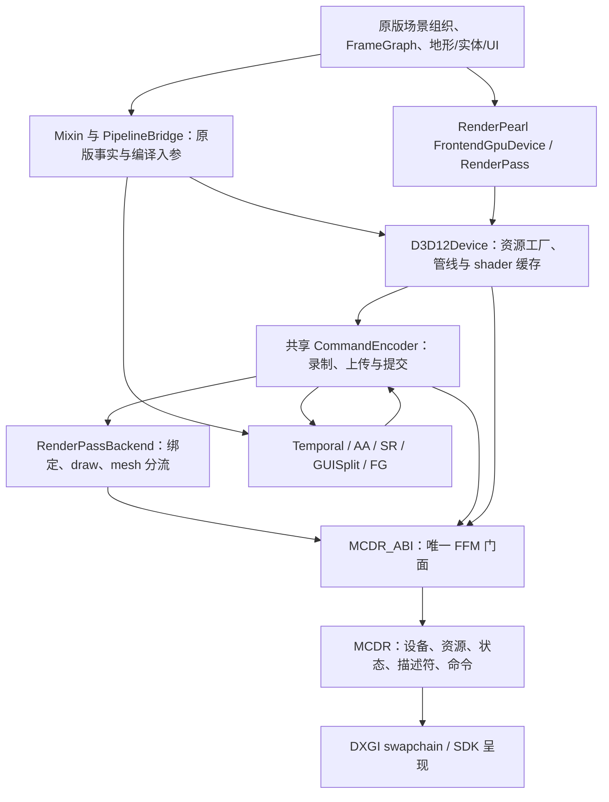

# 原版路径的 D3D12 架构与改进

本页核对当前工作树源码及 NeoForge 26.3 / RenderPearl backend SPI。描述的是原版光栅路径，包括已实现的 mesh、AA、超分与帧生成；集中式 RTX RenderPipeline 尚未实现。
下述缺口来自静态代码与实际依赖接口核对，不代表已在游戏中复现，也不构成 CPU/GPU 性能测量。

基于本次审查的目标架构与实施工作包见 [原版光栅 Work Graph 优化方案](../rendering/vanilla-work-graph-plan.md)。本页继续记录现状，不将目标设计计作已完成修复。

## 1. 实际分层

图中的 Encoder 与业务双向关系是当前事实，也是职责拆分的目标之一。
Minecraft 仍决定世界内容和 pass；D3D12 backend 接收原版命令并翻译，当前没有接管整套世界渲染图。

| 当前层 | 实际职责 |
| --- | --- |
| bootstrap / backend | 外层 early-service 建立无 GL 的 SDL 窗口，D3D12Backend 接管同一窗口；创建设备、执行启动自检 |
| Device | 资源工厂、共享 encoder、普通/flipY 管线缓存、shader 缓存、naga 编译器；关闭顺序和能力信息 |
| CommandEncoder | 一个设备的原版帧命令汇入共享 context；拷贝、清屏、瞬时上传、同步/异步提交，以及目前夹在其中的后处理业务入口 |
| RenderPass | 暂存 uniform/texture/vertex/index 绑定，绘制前推送脏描述符；普通 draw、indirect draw、地形 mesh 分流及 VRS 作用域 |
| 资源包装 | JVM 持有 native 不透明句柄；纹理/view 计数、buffer map、query、surface 与关闭入口 |
| shader | 原版 GLSL 与 include/defines → naga HLSL + manifest → 阶段接口/绑定校验 → DXC DXIL → root signature / PSO |
| FFM / native | 唯一 MCDR_ABI 下发版本化参数；native 持有真实 D3D12 对象、barrier、descriptor heap、队列和 fence |
| render 业务 | 时域状态、速度、AA/SR、世界/UI 分离、FG 与延迟控制；目前仍通过若干原版 hook 和共享 encoder 接线 |

PipelineBridge 用原版管线名称补齐 CreateInfo 没有携带的 RenderPipeline/ShaderSource，不能把它当作已经具备版本化源资产的编译服务。
naga 前端与最终 DXIL 都已有处理/缓存环节；native DXIL 磁盘缓存的键包含 DXC 版本标签、profile、entry 和 HLSL，改进不应重复建设另一套相同缓存。

## 2. 一帧如何走完

1. 原版准备场景与动态几何，并在 Frontend API 上创建 pass、绑定资源、发 draw。
2. D3D12Device 返回共享 encoder；native 选择三路 command-list/allocator 中的一个槽位，并等待该槽位上次使用的 fence。
3. BeginRenderPass 转换附件状态、绑定 RTV/DSV、viewport/scissor。当前实现使用 `OMSetRenderTargets`，没有调用 D3D12 原生 `BeginRenderPass`。
4. 普通绘制按现有 PSO 执行；非地形 indirect draw 使用 ExecuteIndirect。地形 indirect draw 被转换为静态 meshlet atlas + 动态实例/work 表的 DispatchMesh，支持 16/32/64 quad 和 AS 剔除；VRS 在地形作用域生效。
5. 世界 main pass 返回时采集时域数据、生成所需运动信息并复制共享深度快照，避免后续原版清深度破坏 SR 输入。
6. GUI 绘制前，hook 按配置执行 AA、SR、延迟标记和 GUISplit。世界结果进入显示尺寸目标，UI 在对应目标上绘制。
7. surface 将 acquire 推迟到最终 blit；选择实际呈现纹理，录制 back-buffer blit，然后提交并 Present。MV 同帧重复调用有帧号保护。
8. 正常异步路径由 native 提交线程执行 Close/Execute/Signal/Present；下一次录制先结算提交握手。CPU 提交完成与 GPU fence 完成是不同事件。

地形的静态 atlas 已按不可变几何缓存；动态实例/work 表仍随批次生成。64 quad 档不自动更快，其组内输出、剔除粒度和 occupancy 需要实测。

## 3. 两类异步不能混为一谈

**异步提交已接入。** 主线程组织并录制命令，native 线程负责提交和呈现；它不意味着所有 draw 都并行录制，也不代表有独立 compute/copy queue 并行执行。

**旧 bundle 并行录制存在代码，但没有接入当前原版 SPI。**
实际依赖的 RenderPassBackend 暴露 `multiDrawIndexed(...)`，现有 override 在 JVM 中循环调用 `drawIndexed`。
旧 `drawMultipleIndexed(Collection<RenderPass.Draw<T>>, ...)` 不是 override；全源码搜索只找到定义，没有调用方。私有 `tryParallelDrawMultipleIndexed` 仅被这个旧方法调用。
因此 D3D12AsyncContext 的初始化、descriptor 分区和 worker/bundle 池不能作为“当前原版已经并行录制”的证据；旧批次计数也不能用来描述当前实际负载。

## 4. 资源、绑定与状态

- buffer 按 usage 选择 UPLOAD、READBACK 或 DEFAULT。纹理与一般缓冲通过 committed resource 创建，已有缓冲复用池；当前不是完整的 placed-resource/别名内存管理。
- 瞬时上传使用 512 KiB 起的 staging 块和三路池；mapped UBO 另有 3 × 4 KiB ring。native 延迟删除使用队列 fence，不能把“CPU close”解释为 GPU 已完成。
- CBV 使用 root descriptor；texture/texel SRV 使用分段 shader-visible heap。native 已缓存同命令列表的相同 texture SRV 表，不是每次必定重新复制所有描述符。
- JVM 脏绑定仍需按字符串查找、创建六个平行数组，再由 FFM 转为 binding-slot 内存；这部分还有减少分配和重复编码的空间。
- native 在使用点自动转换状态。pass 结束把附件退回 COMMON，列表结束处理其余资源，下一列表清空跟踪状态。这是现有跨列表约定，优化时不能只删除 barrier。
- SDK 调用可能改变 command-list 状态；heap 恢复已有接线，但仍需要统一、明确地声明 root signature、PSO、descriptor 和资源状态的失效边界。

## 5. 优先修复的正确性缺口

下列是实现或接口契约的静态缺口，触发条件和游戏中的出现频率需要分别验证。

| 优先级 | 已核对事实 | 触发与改进要求 |
| --- | --- | --- |
| P0 | `settlePendingSubmit` 在等待前清掉 pending，等待超时只打印警告；native 超时没有确认释放 context 所有权 | 超时后下一次录制/关闭可能继续访问提交线程仍持有的 context。成功握手才清 pending，失败进入不可继续录制的状态 |
| P0 | `allocateGpuMapped` 忽略 alignment，满 4 KiB 就切下一 ring 槽，三槽可以在同一帧回绕，也不处理单次超 4 KiB | 两次不规则大小分配可违反对齐；同一帧第四次 4 KiB 分配覆盖第一次。改成按提交 fence 管理的上传页，按请求对齐，溢出扩页，禁止复用未完成页 |
| P0 | 描述符 heap 耗尽时，只要上一张 SRV 表数量相同就强制复用，不再要求资源相同 | 不同纹理可能绑定成旧纹理；texel SRV 路径还可能改写正在被命令引用的槽位。采用有寿命的溢出页/扩容，不能以错误绑定返回成功 |
| P0 | copy 回调进入全局队列，submit 后立即取出执行；native submit 不等 GPU，READBACK map 也不等待 | backend 没有提供“拷贝已完成”的保障，其他 encoder 还可能提前取走回调。回调携带 context + submission/fence，由完成队列触发；调用方额外等待不能代替 backend 契约 |
| P1 | 当前实际 multiDraw override 逐 draw 下发；旧 bundle 方法没有调用方 | 将真正的 SPI 批次一次编码到 native，保留原始顺序；移除失效入口、对应常驻资源和失真指标，按实际负载决定 bundle 使用范围 |
| P1 | `pushConstants` 只告警并忽略；分离参数的两个 multiDraw overload 直接抛 UnsupportedOperationException | 依赖这些接口的调用会失败或获得错误数据。完整映射 root constants/布局；未支持能力必须在管线创建阶段明确拒绝 |

另有需要纳入资源契约的检查：`blockSizeFor` 当前把 D32_FLOAT 与 D32_FLOAT_S8X24 的 4/8 字节分类颠倒，且该表用于 copy footprint/texel buffer 构造。
应统一格式元信息，并以 `GetCopyableFootprints` 处理真实 subresource/plane 布局；不能仅调换两个数字就认为深度/模板的所有拷贝已正确。
worker 退出路径在 `shutdownNow()` 后直接销毁 native pool，亦没有第二次完成确认；当前旧入口未接入不等于可以把该生命周期原样带入新批次路径。

## 6. 结构与性能改进的确定顺序

### 6.1 统一提交与资源寿命

以 SubmissionToken 明确区分“命令录制完成”“CPU 提交完成”“GPU 消费完成”。
command allocator、staging 页、descriptor 页、readback 回调、query 结果、SDK context 都绑定实际消费 token。
超时不更改所有权；错误/取消/设备关闭使用同一状态机。native per-context fence 与全局 queue fence 的数值不能互换。

### 6.2 按职责封装，消除反向依赖

| 模块 | 拥有内容 | 不允许承担 |
| --- | --- | --- |
| Minecraft 适配 | 原版 hook、PipelineBridge、资源包与 draw/pass 语义采集 | SDK 状态机、native 资源退休 |
| 通用 D3D12 backend | device/caps、资源分配、binding layout、pipeline、命令和提交 token | 根据地形名称、GUI usage、SR provider 决定渲染业务 |
| TerrainDrawDispatcher | mesh 描述符、驻留与批次选择 | 修改通用 encoder 的生命周期规则 |
| VanillaFrameCoordinator | 世界结束、输入捕获、AA/SR、UI、真实帧输出顺序 | 直接操作 SDK 私有 descriptor/模型布局 |
| Reconstruction / Presentation | 各自算法、历史、context 和图资源租约 | 各自发明独立帧号、全局活动设备、重复 Present |
| MCDR_ABI | 唯一 FFM 门面，版本/布局/错误检查 | 读取业务配置并决定渲染策略 |

JVM 保持 Kotlin 优先；底层调度通过明确参数取得 profile/诊断状态，消除 MCDR_ABI 对 D3D12Settings 的反向依赖。
native 按 resource allocator、descriptor allocator、command recording/state、submission/retirement 拆分 `d3d12_device.cpp` 的状态所有者。
单纯移动函数到新文件而继续共享整套可变 gCtx 不能完成该拆分；C++ 模块身份、唯一 FFM 出口和现有 ABI 边界仍保留。

### 6.3 优化真实热路径

1. 管线编译时生成不可变 BindingLayout；draw 使用整数 slot 和复用编码区，消除六个平行临时数组及重复字符串查找。沿用已有 native SRV 去重，并扩展为具有明确布局/资源版本键的绑定包。
2. 给实际 `multiDrawIndexed`/`multiDraw` 增加批量 ABI。相同状态只绑定一次，以一批命令跨越 FFM；保持顺序敏感透明内容的语义，不直接把旧的 Draw<T> 适配代码搬到新接口。
3. 建立统一的 native 资源访问描述与跨列表状态交接，按 subresource 合并 barrier，消除不必要的 RT→COMMON→SRV 往返。资源状态跟踪稳定之后再用 measured pass 数据决定 Enhanced Barriers 与队列拆分。
4. 管线编译拆成源解析/manifest、布局链接、HLSL/DXIL、PSO 四类缓存，键包含来源版本、include/defines、布局、变体及工具链版本。利用已有 DXIL 缓存，处理 naga 首次反射转换与最终转换的重复工作；预热任务发布前检查资源 epoch。
5. 内存方面优先统计 committed resource 数、pool 高水位与实际显存，再对大量小资源使用 placed allocation；渲染中间目标按明确的生命周期复用/别名，禁止仅凭尺寸匹配复用仍被 GPU 消费的资源。

这些项目的收益不能从代码行数或 API 次数直接推成 FPS。一次串行 FFM 批次通常比初始化一个没有实际调用方的 worker 子系统更值得先验证。

### 6.4 让 PIX / Nsight 数据可解释

当前 RenderPass 的 `pushDebugGroup/popDebugGroup` 只修改计数，没有把原版标签下发为 GPU marker；Device 的 `getLastDebugMessages` 返回空、`isDebuggingEnabled` 恒 false。
应将原版 pass 标签、地形批次、上传、重建、UI 与 Present 映射到 native GPU events，公开实际 debug-layer 状态。
计时分开记录 Java 准备、FFM 编码、native 录制、提交握手、GPU pass 与 fence 等待；query 延迟读取，不能为获取性能数字强迫每帧等待 GPU。

## 7. 源码证据导航

| 文件与位置 | 核对内容 |
| --- | --- |
| `src/main/kotlin/io/github/dxegp/d3d12/device/D3D12Device.kt:199` | 共享 encoder 与管线编译入口 |
| `src/main/kotlin/io/github/dxegp/d3d12/command/D3D12CommandEncoderBackend.kt:111` | pending submit 与超时处理 |
| 同文件 `:387`、`:441` | 回读回调与 submit 顺序 |
| `src/main/kotlin/io/github/dxegp/d3d12/resource/D3D12TransientMemory.kt:77` | mapped UBO ring 分配 |
| `src/main/kotlin/io/github/dxegp/d3d12/command/D3D12RenderPassBackend.kt:254`、`:301` | push constants 与六数组绑定编码 |
| 同文件 `:534`、`:720`、`:1125` | 当前 SPI、旧 bundle 实现与无调用方入口 |
| `src/main/kotlin/io/github/dxegp/d3d12/shader/D3D12ShaderCompiler.kt:21` | naga 反射与最终阶段链接 |
| `src/main/java/io/github/dxegp/mixin/antialiasing/GameRendererSmaaWorldMixin.java:28` | GUI 前的实际业务顺序 |
| 相邻 MCDR `src/backend/device/d3d12_device.cpp:2444`、`:2853` | 三路 command-list 与不等待 GPU 的提交 |
| 同文件 `:5087`、`:7183` | descriptor exhaustion 与异步完成握手 |
| 同文件 `:2011`、`:2184`、`:3725` | READBACK map、格式表、pass 结束状态转换 |

Redstone 的业务边界、输入和实施工作包见 [redstone plan.md](<../rendering/redstone plan.md>)。
