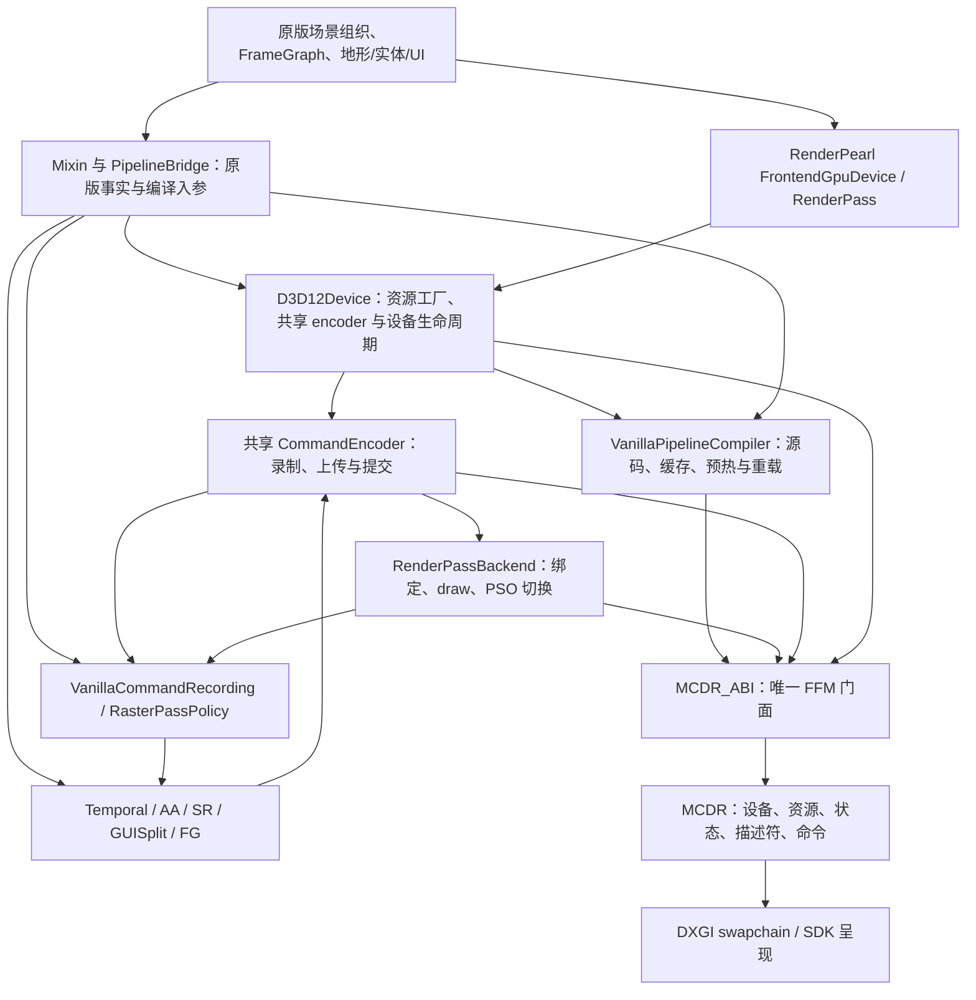

# 原版路径的 D3D12 架构与改进

本页描述 NeoForge 26.3 / RenderPearl backend SPI 的当前原版光栅架构、实际职责与剩余边界。
当前实现、剩余边界与验证证据以 [Work Graph 实施记录](../rendering/work-graph-implementation.md) 为准。本页的源码描述不构成 CPU/GPU 性能测量。

目标架构与实施工作包见 [原版光栅 Work Graph 优化方案](../rendering/vanilla-work-graph-plan.md)。

## 1. 实际分层

录制会话从 `D3D12Backend.createDevice` 注入，每个 encoder 独立持有；底层只依赖中立接口，业务会话负责时域回执、帧声明、绘制分类和地形策略。
Minecraft 仍决定世界内容和 pass；D3D12 backend 接收原版命令并翻译，当前没有接管整套世界渲染图。

| 当前层 | 实际职责 |
| --- | --- |
| bootstrap / backend | 外层 early-service 建立无 GL 的 SDL 窗口，D3D12Backend 接管同一窗口；创建设备并检查能力契约 |
| Device | 资源工厂、共享 encoder、能力信息与关闭顺序；编译 SPI 委托注入的中立 compiler |
| 编译业务 | `VanillaPipelineCompiler` 拥有普通/flipY/source/shader 缓存、naga 编译、预热和重载事务；`VanillaPipelineVariants` / `TerrainPipelineCompiler` 负责 motion、宽线与地形 WG 变体 |
| CommandEncoder | 一个设备的原版帧命令汇入共享 context；拷贝、清屏、瞬时上传、同步/异步提交；通过注入会话接收业务录制要求 |
| RenderPass | 暂存 uniform/texture/vertex/index 绑定，推送描述符、direct/bulk/indirect draw、PSO 切换和恢复；业务 policy 提供地形路由、motion 数据和 VRS 作用域 |
| 资源包装 | JVM 持有 native 不透明句柄；纹理/view 计数、buffer map、query、surface 与关闭入口 |
| shader | 原版 GLSL 与 include/defines → naga HLSL + manifest → 阶段接口/绑定校验 → DXC DXIL → root signature / PSO |
| FFM / native | 唯一 MCDR_ABI 下发版本化参数；native 持有真实 D3D12 对象、barrier、descriptor heap、队列和 fence |
| render 业务 | 时域状态、速度、AA/SR、世界/UI 分离、FG 与延迟控制；目前仍通过若干原版 hook 和共享 encoder 接线 |

PipelineBridge 用原版管线名称补齐 CreateInfo 没有携带的 RenderPipeline/ShaderSource，不能把它当作已经具备版本化源资产的编译服务。
naga 前端与最终 DXIL 都已有处理/缓存环节；native DXIL 磁盘缓存的键包含 DXC 版本标签、profile、entry 和 HLSL，改进不应重复建设另一套相同缓存。

## 2. 一帧如何走完

1. 原版准备场景与动态几何，并在 Frontend API 上创建 pass、绑定资源、发 draw。
2. D3D12Device 返回共享 encoder；native 选择三路 command-list/allocator 中的一个槽位，并等待该槽位上次使用的 fence。
3. BeginRenderPass 转换附件状态、绑定 RTV/DSV、viewport/scissor。当前实现使用 `OMSetRenderTargets`，没有调用 D3D12 原生 `BeginRenderPass`。
4. 普通绘制按现有 PSO 执行，direct/bulk/indirect 的实际读取进入同一 native 资源调度；非地形 indirect draw 使用 ExecuteIndirect。地形使用静态 meshlet atlas 和 section/instance 范围输入，由 Terrain Work Graph 生成可见记录与间接 mesh 参数，再以 ExecuteIndirect 绘制；VRS 在地形作用域生效。
5. 世界与 AfterLevel 绘制完成后采集时域数据、运动和共享深度，发布世界 PreparedFrame 并执行 AA/SR；随后将结果交给显示尺寸 SceneDisplay。
6. 第一人称手部、screen effects、outline 和 post 沿原版顺序继续绘制，GUI 前封存最终场景。GUI 在独立 UiDisplay 上绘制；模糊背景先合并 scene 与已画 GUI，保留 before-blur 内容。
7. `beforeGui` 在现有 GuiReady 后 Prepare，冻结显示输入并先提交 world + guides，保存准确 guide fence 后换 ring；CPU 随后录制 GUI。`afterGui` Submit 只补 UI/backdrop，核对冻结值、等待该 guide fence 并回读同帧有效性，通过后 native 才向选定 FG adapter 提交。中间提交不创建最终 Present ticket。完整 composite 随后生成，普通 F2 与 Tracy 读取它。
8. surface 将 acquire 推迟到最终 blit；FSR 当帧 UI readiness 成功才选 scene-only，其余使用完整 composite。正常异步路径由 native 提交线程执行 Close/Execute/Signal/Present，并按不可变 ticket 提交历史。没有 Present 的帧显式取消匹配 ticket、清理当前帧；下一次录制结算提交握手，display begin 在清 UI 前等待上一帧 Present 与 SDK 源读取。

地形静态 atlas 按不可变几何缓存，CPU 提交紧凑候选范围，GPU 生成可见工作记录。mesh 变体的组内输出、剔除粒度和 occupancy 收益仍需实测。

## 3. 两类异步不能混为一谈

**异步提交已接入。** 主线程组织并录制命令，native 线程负责提交和呈现；它不意味着所有 draw 都并行录制，也不代表有独立 compute/copy queue 并行执行。

**当前 JVM 没有 bundle 并行录制 owner。** 无调用方的 `D3D12AsyncContext`、`asyncCommandLists` / `asyncWorkers` / `commandBundles` 配置和闲置 bundle/executor/prepass/分区描述符 FFM 包装已移除。Native ABI7 的相关公开导出与正确实现为外部兼容继续保留，当前 JVM 不初始化这些池。
实际 `multiDrawIndexed` / `multiDraw` 通过有序批量 ABI 提交，motion 批次保留逐项参数与完整输入 union。普通 direct / multiDraw / indirect 输入声明和紧凑 scheduler 已接入；这不代表并行录制或性能收益。
真实 `AsyncRenderer` 由 `D3D12Device` 创建/关闭；encoder 先结算 CPU 提交握手，再按实际 GPU fence 退休资源。删除闲置 owner/config 不改变该路径。

## 4. 资源、绑定与状态

- buffer 按 usage 选择 UPLOAD、READBACK 或 DEFAULT。纹理与一般缓冲通过 committed resource 创建，已有缓冲复用池；当前不是完整的 placed-resource/别名内存管理。
- 瞬时上传与 mapped 分配由 `D3D12TransientMemory` 的实际 fence 生命周期管理。native 延迟删除使用队列 fence，不能把“CPU close”解释为 GPU 已完成。
- CBV 使用 root descriptor；texture/texel SRV 使用分段 shader-visible heap。native 已缓存同命令列表的相同 texture SRV 表，不是每次必定重新复制所有描述符。
- JVM 通过可复用 binding packet 和批量 FFM 编码提交绑定；native 根据实际 SRV/IA/indirect 来源导入输入范围，兼容 read state 合并后在实际 draw 消费点执行。
- native 在使用点自动转换状态。pass 结束把附件退回 COMMON，列表结束处理其余资源，下一列表清空跟踪状态。这是现有跨列表约定，优化时不能只删除 barrier。
- SDK 调用的 graphics/descriptor effects 由实际业务声明，native 恢复/失效相应绑定；普通 raster parent 只承担附件范围，input child 保留 enclosing graphics 状态。

## 5. 当前剩余边界

当前源码为 ABI11、世界 schema2、显示 schema2，显示帧 672 字节布局保持不变；mesh 描述符为 104 字节，显式携带 raw MRT 标记。JVM 在世界渲染前冻结实际相机、投影、jitter、真实开始时间、尺寸和配置，native 同步复制完整帧；实际 depth/motion/exposure/mask 录制完成后只发布一次 PreparedFrame，在手部和晚期效果之前完成世界 AA/SR。SceneDisplay 继续承接手部/后处理，UiDisplay 单独绘制 GUI；显示输入按 GUI 前 Prepare、GUI 后 Submit 两阶段接线，具体冻结值、独立 coverage、fence 与返回值契约见 [FFM ABI](ffm-abi.md)。公开的独立每帧 SDK 参数入口已删除，配套构建和运行覆盖见[实施记录](../rendering/work-graph-implementation.md#当前构建与运行)。

通用 device/encoder/pass 通过构造注入的 compiler、录制会话和 policy 接收业务策略。terrain 驻留归每个会话，随 command context 完成后释放；地形采样器由录制工厂在 encoder 完成后释放。提交模式由 Backend 读取配置后作为枚举传入设备。pipeline 分类、地形/motion/VRS 策略、源码缓存与重载事务都留在业务域。`checkD3D12Dependencies` 在编译前拒绝 device、command、编译产物/转换缓存和 FFM 核心文件对 render/config 的直接依赖，Backend 负责组合实际业务实现。

当前已接入普通 direct / multiDraw / indirect 输入声明和紧凑资源调度，AA/SR/FG 共享冻结帧与已发布准备输入。世界与 viewmodel 分别拥有运动和 coverage；实体、持物、粒子、天空/天体及透明贡献的当前来源范围集中见[实施记录](../rendering/work-graph-implementation.md#abi10-运动来源与像素贡献)，完整 guides 仍有明确缺口。SDK 全面质量与性能结果尚未建立。

CPU 提交握手与 GPU fence 完成继续是不同生命周期事件。保留的 native bundle/executor ABI7 实现为外部兼容服务，当前 JVM 不创建其 owner；实际设备 AsyncRenderer 与 encoder 的提交/退休路径独立保留。当前实施及具体场景证据统一见 [Work Graph 实施记录](../rendering/work-graph-implementation.md)，后续设计和工作包见 [主计划](../rendering/vanilla-work-graph-plan.md)。

## 6. 当前源码职责导航

| 来源 | 当前职责 |
| --- | --- |
| `d3d12/device/D3D12Device.kt` | 设备、资源工厂、共享 encoder、实际 AsyncRenderer 的创建与关闭；编译 SPI 委托 |
| `render/compilation/VanillaPipelineCompiler.kt`、`VanillaPipelineVariants.kt` | 源与编译缓存、重载/预热事务、descriptor 翻译和业务变体编排 |
| `render/terrain/mesh/TerrainPipelineCompiler.kt` | 地形 shader/PSO/WG 生成；成功后一次移交产物所有权 |
| `d3d12/command/D3D12CommandEncoderBackend.kt` | 原版命令录制、提交握手、fence 退休和业务会话调用顺序 |
| `d3d12/command/D3D12RenderPassBackend.kt` | 实际绑定包、常量、IA、direct/bulk/indirect 与 PSO 恢复 |
| `render/frame/vanilla/VanillaCommandRecording.kt`、`render/frame/vanilla/VanillaRasterPassPolicy.kt` | 每 encoder 的业务资源、投影回执、父声明、地形/motion/VRS 策略 |
| `d3d12/resource/D3D12TransientMemory.kt` | 瞬时上传和 mapped 分配资源生命周期 |
| `render/frame/vanilla/VanillaFrameCoordinator.kt` | 冻结完整帧、世界/post/GUI 顺序、声明 pass 和 PreparedFrame 发布边界 |
| `render/temporal/`、`render/reconstruction/`、`render/presentation/` | 现有时域来源、重建输入与 provider、呈现业务状态和租约 |
| `d3d12/ffi/MCDR_ABI.kt` | 唯一 FFM 参数、版本/布局与错误通道 |
| 相邻 MCDR `src/render/vanilla/d3d12_vanilla_frame.cpp` | frame phase、实际附件/input importer、资源声明与 adapter 调度 |
| 相邻 MCDR `src/render/vanilla/vanilla_pass_scheduler.h` | 实际 subresource 访问 frontier 与资源依赖 |
| 相邻 MCDR `src/backend/device/d3d12_device.cpp` | 实际资源/view 元数据、D3D12 状态/绑定/队列和 context 生命周期 |

JVM 路径均相对 `src/main/kotlin/io/github/dxegp/`。表中列出职责入口，不使用会随实现变动而失效的旧审计行号。Redstone 业务边界另见 [redstone plan.md](<../rendering/redstone plan.md>)。
