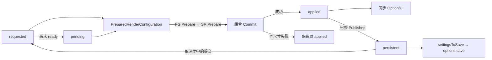

# 渲染配置契约

RenderConfiguration 统一拥有 requested、真实候选、applied 和 persistent。requested 表达用户想用的配置；PreparedRenderConfiguration 准备实际资源与 native provider；FG Prepare、SR Prepare 和组合 Commit 成功后发布 applied。persistent 是可保存的完整配置，首次加载后以磁盘值初始化，之后只在完整 Published 时更新；临时 resize NONE 配置只更新 applied。

`pending` 表示请求仍在等待真实帧、设备、尺寸或 provider 条件。相同显示尺寸下，准备失败或 Commit 拒绝保留原 applied。取消仍在忙的 UI 提交会把 requested 恢复为 persistent；若它与当前临时 applied 不同，继续准备恢复，而不把临时配置保存成用户偏好。

AA、scale、DLSS、SR 和 FG 的 save 都读取 settingsToSave，也就是 persistent。窗口变化产生的临时 applied 不覆盖它，尚未进入世界的初始磁盘偏好也不会被默认值或临时 NONE 配置覆盖。

首次 Options 加载由单个 Kotlin OptionsRenderOptionsMixin 在 load 尾部调用 loadSavedSettings，一次读入 AA 和其他渲染选项，批量完成后才归一化 requested 并初始化 persistent。save 尾部再由各业务按自己的键写回同一文件；AA 没有独立的加载/保存 mixin。

主菜单提交 SR 时没有可用世界相机，返回 `Outcome.AwaitingWorld` 结束本次 UI 回调，同时保留 requested/pending。设置界面可以正常关闭和重开，并显示“超分设置已暂存，进入世界后应用；成功后保存”。进入世界后继续准备，成功发布才保存所请求的配置。

## 尺寸变化与实际比例

每帧先在 Minecraft.renderFrame HEAD 记录开始时间，再完成 window configure。GameRenderer.render 的 beginDisplayFrame 按本帧窗口尺寸 resize 原版目标，随后 applyPendingAtFrameStart 发布配置，再开始 native display frame；后续实际投影上传才按已经发布的尺寸和配置计算 jitter。时间记录阶段不提前应用配置。

窗口已 resize 时，旧世界附件尺寸无法继续作为当前显示配置。若目标配置尚未 ready，先准备并发布匹配新窗口的 `NONE / AA OFF / FG OFF / 100%` 临时配置，保留 requested，后续真实帧继续准备。若 SDK 在同一显示尺寸拒绝该请求，保留这份可渲染临时配置并暂停该尺寸下的自动重试；新的设置请求或新的窗口尺寸再推进。失败时不保存未生效请求。

| 场景 | 生效值 | 请求去向 |
| --- | --- | --- |
| 同尺寸准备失败 | 保留原 applied | 结束失败的提交 |
| resize 后尚未 ready | 发布新尺寸的临时 NONE 配置 | 保留 requested，继续准备 |
| resize 后 SDK 拒绝 | 保留新尺寸的临时 NONE 配置 | 同尺寸暂停，等待新请求或新尺寸 |
| 主菜单等待世界 | 保留已发布的可渲染配置 | 保留 requested/pending，返回 AwaitingWorld |

`Settings.renderScalePercent` 表达用户质量/比例偏好；`Applied.renderScalePercent` 记录真实使用比例。小窗口按后端 caps 的最小输入宽高向上抬高实际比例，最高 100%，并校验真实尺寸；用户存储的质量档位保持原值。显示尺寸连后端最小输入都无法满足时，按上述拒绝/resize 规则处理。

准备阶段创建候选世界附件、输出纹理、曝光和 provider 资源，并校验当前窗口、渲染尺寸、世界帧身份、能力和资源版本。候选资源在 Commit 前属于候选对象；失败时按租约退休，已发布资源继续由原 owner 持有。尺寸变化走同一配置候选流程，不能从 setter 直接触发破坏性重建，也不能跨门面加锁写配置。

帧内顺序固定为：`FG Prepare → SR Prepare → 组合 Commit → 世界附件发布`。世界输出由 `VanillaWorldOutput` 只负责分配资源和提交事实；原生 `prepareWorldOutput` 统一完成曝光、mask、选中的 AA/SR、后置锐化及 `SceneDisplay` 输出。JVM 不再逐帧拼 SDK 参数、执行各 pass 或维护 SDK 历史。

Streamline SR 使用候选 viewport 中可用的 `2..4` 槽位，现役 viewport 随候选发布；FG 使用 `viewport1`。候选只有在 Commit 后才成为现役，失败时释放候选并保留旧槽位。

## SR Prepare 与关闭

`mcdr_dx12SrPrepare` 返回 `int32` 状态，独立 `uint64` outToken 表达候选所有权：Ready=1、NotReady=0、InvalidArgument=-1、Rejected=-2、CompletionUnknown=-3。FFM 将结果转为 typed status；未知完成结果继续持有候选与资源，不能按无副作用失败释放。

FG Prepare 同样返回 int32 状态和独立候选 token：Ready=1、NotReady=0、InvalidArgument=-1、RestartRequired=-2、ProviderRejected=-3。NotReady 用于先前显示帧、录制、Present 或 provider 输入尚未退休的等待；SDK 不支持、参数档位拒绝归 -3。FFM 的 FgPreparation 区分 Ready、NotReady 和带失败类别的 Rejected；调用完成结果未知时保留 token 与相关资源。

`SR_DISPATCH` 为 152 字节，`pCamera` 指向真实的 256 字节 `RASTER_CAMERA`，与候选尺寸和冻结世界帧配对。Streamline 候选资源准备使用独立 frame0 allocation token；正式帧统一通过 `++gReflex.frameCounter` 从 1 开始取 token，避免候选与正式帧相撞。

配置 retirement 向所属 encoder 正向登记 `AutoCloseable`，device 不反向引用配置域。native `destroyDeviceChecked` 在提交完成、GPU idle 后依次确认 FG、SR provider 和 SDK 释放成功，随后才清空设备；任一步失败保留设备与剩余 owner。

## 输入语义

- FSR 使用 `reactive`；它描述历史不可信的反应区域。
- FSR 在有 OIT 两个来源时还使用 `composition`；它描述透明/合成贡献，不能当作 reactive 的别名。
- XeSS 使用 `responsive`；它是 XeSS 的响应区域语义，不能把其他 mask 的数值直接复用。
- mask 是 native frameprep 在真实世界输出阶段生成的纹理，不再做旧式 CPU 均值读回或固定的生产 mask。
- 天空/天体与透明像素贡献的来源覆盖集中见[实施记录](work-graph-implementation.md#abi10-运动来源与像素贡献)；来源不完整或 post 映射未知时 FG 跳过，普通世界绘制继续。

同帧 FG validity 汇总已接入 `beforeGui` 提交、`afterGui` 等准确 guide fence 后同帧读取的两阶段路径，协议见 [FFM ABI](../misc/ffm-abi.md)。配套构建、实际运行、性能与 resize 后退出确认集中见[实施记录](work-graph-implementation.md#当前构建与运行)。
