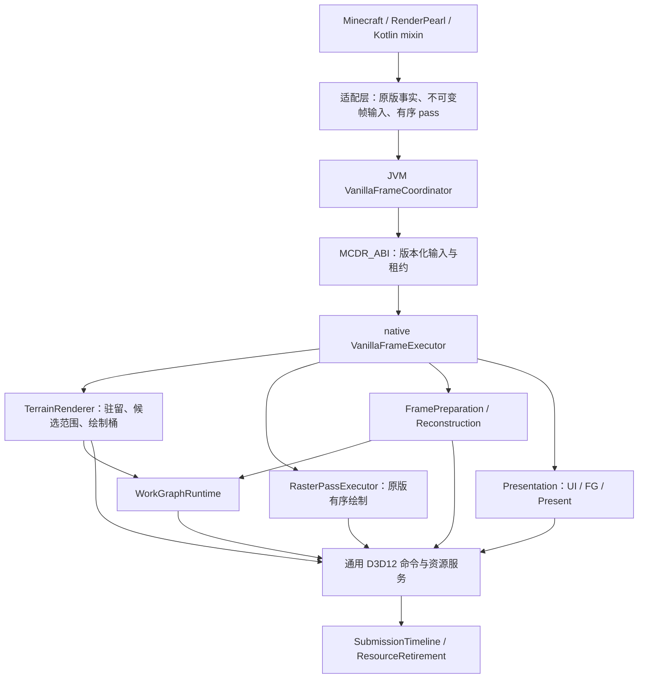
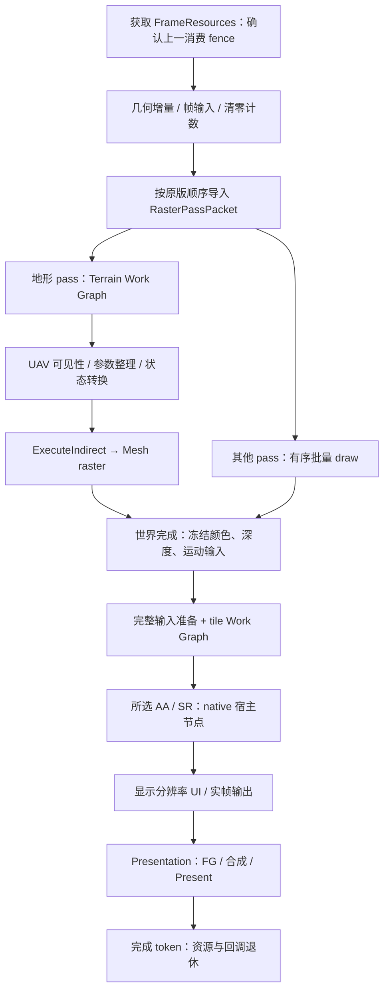

# 原版光栅路径：Work Graph 架构优化方案

状态：实施中，2026-11-11；本页保留完整目标契约，逐项进度以实施记录为准。范围是现有 Minecraft / RenderPearl 的 D3D12 光栅路径、mesh、AA/SR 与呈现，不包含光追、降噪器、辐射缓存和世界输运。
现状与缺陷证据见 [原版 D3D12 架构审查](../misc/vanilla-d3d12-architecture.md)。本页规定重构后的职责和执行契约，不将这些能力描述为当前已经实现。

任务分工、依赖和实际完成情况见 [实施记录](work-graph-implementation.md)。

## 1. 确定的工程决策

1. native `VanillaFrameExecutor` 管理帧内依赖、资源状态和执行；GPU Work Graph 管理局部、数据驱动的工作扩展。两者分别解决帧调度和 GPU 工作分发。
2. 地形使用 **compute Work Graph → 可见 meshlet 列表 → 参数整理 → ExecuteIndirect / DispatchMesh**。选用 Work Graph Tier 1.0 的能力集合；此架构不依赖 graphics/mesh nodes 扩展。
3. 保留现有 meshlet atlas、几何 owner、实际 draw 快照与重建输入/历史抽象；移除 CPU 每帧逐 meshlet 展开工作项的职责。静态数据按增量上传，帧输入按 section/instance 范围提交。
4. 所有原版 pass 经过显式的顺序和资源契约。只有已知语义的地形段交给地形调度器；实体、手持物、粒子和 GUI 的原版着色与顺序由批量命令路径承接。
5. 本方案使用一条 DIRECT queue 执行光栅、Work Graph、普通 compute 和 SDK 命令；提交线程负责录制结果的提交与呈现交接。不开设额外 async-compute/copy queue，不以旧 bundle 子系统为核心。
6. 先统一 submission/fence 与资源寿命，再接入 GPU 工作分发。不得让 Work Graph 继承当前 UBO 回绕、描述符误复用或超时后继续访问 context 的缺口。
7. Kotlin 继续作为 JVM 业务与 mixin 的首选；`MCDR_ABI` 保持唯一 FFM 出口。SDK context、descriptor、GPU 地址和图内部记录均归 native。
8. 所选配置缺少必需能力时明确拒绝启用；配置发布采用帧边界事务。既有生效配置的保留属于事务失败语义，不得报告新配置已生效。

Work Graph 不会减少 Minecraft 的 Java 场景提取、区块网格构建或 mod 回调成本；批量 ABI、增量驻留与采集粒度调整分别处理这些边界上的开销。

## 2. API 与编译边界

| 项目 | 本方案的确定做法 |
| --- | --- |
| Work Graph 能力 | 查询 `D3D12_FEATURE_D3D12_OPTIONS21.WorkGraphsTier`，要求至少 Tier 1.0；不能用厂商、SM 版本或 FL 标签推断支持 |
| mesh 能力 | 独立查询 mesh shader tier；Work Graph 支持不自动代表 mesh shader 支持 |
| 编译目标 | 复用当前 SM6.9 / Agility 装载体系；内置节点使用原生 HLSL，由 DXC 编译为 `lib_6_9`，另行验证 node 编译及 state object 创建 |
| SM6.9 定位 | WG 基础 API 来自 SM6.8；当前源码的图形编译已要求 6.9，本方案沿用现状，但能力目录分别记录 WG、mesh、6.9 与各 SDK 需求 |
| CoopVec | 作为独立能力和编译需求登记；本次没有自有神经网络计算，不为“使用 6.9”向剔除/压缩流程添加网络。SR SDK 的内部模型仍由 SDK 执行 |
| shader 服务 | 原版 GLSL 经 naga → HLSL → DXC；内置 HLSL/node 直接进入统一 manifest/布局校验与 DXC 服务，无需先反向送入 naga |
| 图运行 | `CreateStateObject`、`ID3D12WorkGraphProperties`、program identifier、`SetProgram`、`DispatchGraph` 封装在 native `WorkGraphRuntime` |
| GPU 入口 | 通过 `DispatchGraph` 的 GPU-input 模式消费 GPU 记录；不能把 `DispatchGraph` 当成已支持的 `ExecuteIndirect` argument type |
| 光栅出口 | WG 写可见表和计数；整理参数后以 `ExecuteIndirect` 的 `DISPATCH_MESH` argument 消费，PSO、RTV/DSV、root layout 由宿主绑定 |
| SDK 边界 | DLSS/FSR/XeSS、FG SDK 调用属于 native 帧图中的宿主录制节点，GPU node 不能调用 C/C++ SDK 或 Present |

Microsoft 的基础 Work Graph 规范与 mesh nodes 预览资料具有不同的能力/发布条件。本方案选择 compute WG 与标准间接 mesh 绘制的组合，按该组合完成工程，不依赖 mesh nodes 普遍可用的假设。
WG 使用 `D3D12_STATE_OBJECT_TYPE_EXECUTABLE`；使用 state object 不要求引入 DXR、BLAS 或 TLAS。
`lib_6_9` 编译器、实际 Agility core、驱动、WG tier、mesh tier、节点状态对象创建结果分别记录到启动诊断。源码当前选择 Agility 619；打包与调试层必须使用匹配的运行库，不能仅根据编译时头文件宣布运行时支持。

编译入口抽象为产出 manifest、BindingLayout、NodeRecordSchema、所需能力和工具链指纹的服务。naga/DXC 细节不进入帧协议；既定 Zig processor 完成后替换编译 provider，不修改业务输入和 WG 运行契约，也不增加 SPIRV-Cross 回退。

## 3. 业务模块与依赖

| 模块 / 建议目录 | 拥有状态与输出 | 依赖约束 |
| --- | --- | --- |
| JVM `render/frame/vanilla` | `VanillaFrameCoordinator`、真实帧号、采集阶段、帧资源租约 | 调用版本化 native 会话，不执行 SDK 内部 pass |
| JVM `render/terrain/mesh` | 现有几何 owner、不可变几何增量、实际 draw 快照 | 不拥有 GPU 驻留排序，不逐 meshlet 构建每帧工作表 |
| JVM Minecraft 适配层 | 将原版 pipeline/pass 转成 `PassRole`、`PipelineSemantic`、`OrderPolicy` | 名称/usage 识别集中于适配边界，通用 D3D12 层不得猜业务 |
| native `render/vanilla` | `VanillaFrameExecutor`、帧拓扑、pass 导入与业务调度 | 依赖各业务描述和后端服务，不暴露全局可变 frame manager |
| native `render/terrain` | `TerrainRenderer`、GPU 驻留、meshlet 范围、分桶、可见表 | 使用 WG/命令服务，不管理交换链或 SR 历史 |
| native `render/frameprep` | 运动/深度/掩码准备、tile 分类、VRS 生成 | 交付完整输入和明确版本，不推进 SDK 历史 |
| native `render/reconstruction` | AA/SR 组合、算法历史、provider context | 不自行取交换链、递增帧号或调用 Present |
| native `render/presentation` | 世界/UI 合成、FG、pacing、真实帧与显示帧关联 | 唯一呈现 owner，SDK 交换链 hook 也归它管理 |
| native `backend/workgraph` | state object、program、节点记录布局、backing memory 实例 | 不含 Minecraft 名称、材质语义或 SR provider 选择 |
| native `backend/command`、`binding`、`resource`、`submission` | 命令、subresource 状态、绑定页、分配器、提交与退休 | 不反向引用 render；按实例持有状态，禁止拆文件后仍共同修改全部 `gCtx` |

`D3D12Device` 和 encoder 保留通用 SPI 职责；`RenderPassBackend` 将命令编码为批次，不再自己选择地形算法。`MCDR_ABI` 读取 `D3D12Settings` 的依赖改为显式参数；设备和 FFM 不做业务策略决定。

## 4. 跨模块输入契约

以下名称是目标类型，不表示已有导出函数。

| 类型 | 必需内容 | 所有权 / 有效期 |
| --- | --- | --- |
| `VanillaFrameInputs` | schemaVersion、worldEpoch、realFrameId、原点、current/previous 相机、jitter、曝光、尺寸、配置/资源版本 | JVM 冻结，native 校验后复制值；异步引用数据显式保活 |
| `GeometryDelta` | owner identity、generation、layer、顶点/索引与 meshlet 范围、边界、materialVersion、创建/替换/退休事件 | 复用当前 owner；按稳定身份更新 native 驻留，拒绝过期世界/版本 |
| `RasterPassPacket` | pass identity、原始序号、附件/访问、viewport/scissor、整数 BindingLayout、pipeline key、draw 范围、排序语义 | 一个批次跨 FFM，不传 MC 对象、SDK descriptor 或可变 manager |
| `TerrainCandidateSpan` | 冻结 draw 的 owner/version、顶点切片、section/instance、meshlet start/count、绘制桶 key、原始顺序号 | 帧级紧凑候选，驻留对象由本帧租约保活 |
| `PassResourceUse` | resource/version、subresource、读写类型、所需状态、外部调用后的状态/缓存失效范围 | native 编译资源依赖和 barrier，未知副作用是硬批次边界 |
| `SubmissionToken` | device generation、queue/context identity、submission serial、所属 fence identity/value | native 生成；不同 fence 数值不互换，CPU 握手与 GPU 完成分开 |
| `PreparedFrame` | 世界颜色、深度、真实运动、曝光、reactive/composition、输入有效性、realFrameId、完成依赖 | 重建消费；UI 和生成帧不写入世界历史 |

绘制桶包含 layer、pipeline/PSO、binding layout、资源绑定版本、附件、VRS 和 mesh 变体；材质 ID 不足以判断两个 draw 可以合并。
pipeline 编译时生成整数绑定槽和 root constants 布局，draw 热路径复用编码区，消除字符串查找与六组平行临时数组。
批次必须覆盖实际 SPI 的各个 `multiDrawIndexed`/`multiDraw` 重载；不支持的布局在 pipeline 创建时拒绝，不能忽略 `pushConstants`。

原版 FrameGraph 决定的顺序作为输入保留。按实际 pass 分段提交：world-ready 在已知深度清除前产生快照，world-post 在 UI 前完成命令录制；不能等到 Present 才重放已经失效的资源。
同步读取、资源映射、附件变化、第三方录制或不可声明的副作用均结算批次并建立明确边界。批量 FFM 不要求整帧只能一次 downcall。

## 5. 帧执行与 Work Graph 内容

### 5.1 帧级顺序

地形与普通 draw 是不同 pass 的执行方式，不授予它们跨原版顺序任意并行的权限。一个 pass 内只合并状态兼容、允许合并的连续命令。

### 5.2 Terrain Work Graph

确定数据流：`SectionEntry → SectionCull → MeshletRange → MeshletCull → EmitVisible`。

当前地形已经按批次 DispatchMesh；主要目标不是减少不存在的逐 meshlet downcall。`D3D12MeshDrawCapture.buildTables` 的动态上传为 `32 × section 数 + 8 × meshlet 数` 字节，逐帧在 CPU 展开后一个工作表。此次将这部分展开移到 GPU，帧级上传变为 section/instance 范围；初次驻留或几何变更的静态上传仍按真实几何量计费。

- `SectionEntry` 接收 section/instance 范围和驻留表索引，不重复复制 meshlet 描述符。CPU 输入量由 meshlet 数量转为候选 section/instance 数量。
- `SectionCull` 做保守视锥和合法边界检查；版本检查在宿主发布阶段完成，GPU 消费冻结的驻留版本。
- `MeshletRange` 以范围记录扩展工作，使用 broadcasting/coalescing 节点匹配批量大小；不为每个 quad 创建节点记录。
- `MeshletCull` 使用现有保守包围盒、方向掩码和相机数据。越界、双面/非轴向、不适合剔除的几何保持可见，不改变草、花和自定义模型语义。
- `EmitVisible` 在固定绘制桶内写入 `VisibleMeshletRef`，包含 instance 与几何范围索引；小记录通过 node record 传递，静态几何从驻留表读取。

WG 承担细粒度剔除，后续 MS 消费压紧工作项，不重复运行同一套 AS 细剔除。复用 MS 顶点解码与 PS 输出，新增直接读取可见工作表的 MS 入口；16/32/64 变体仍由明确的 pipeline 配置选择。

WG 完成后由宿主 barrier 建立全局完成边界，再录制普通 compute `FinalizeTerrainArguments` 读取计数并生成间接参数。它与可见表之间具有明确 UAV/SRV/INDIRECT_ARGUMENT 状态转换；不能把“终结节点”当成所有其他节点都完成的全局 join。
native 按宿主已知的绘制桶绑定 PSO/附件/布局，再执行 indirect；GPU 不修改任意 PSO。大批次按 DispatchMesh 的维度及总线程组限制切片，参数槽按候选上界预留，计数留在 GPU，不逐帧读回 CPU 决定 draw 数。

容量按候选最坏输出数预先计算；每个候选最多输出一次，节点 `MaxRecords`/dispatch grid 与运行时上界一致。显存预算不足在发布前报告错误；越界计数必须可诊断，不能截断后宣称正常完成。
当前候选来自实际 draw，WG 只能细分/剔除已提交候选，不能恢复原版已经排除的 section。此方案不新建全世界几何镜像，也不宣称消除了原版 CPU 可见性遍历。

### 5.3 遮挡和透明内容

- 基础剔除固定为视锥与方向，不为 HZB 强制增加一遍全世界深度预通过。
- pass 已有合法的本帧保守遮挡深度时，可在资源契约中启用 HZB 输入。HZB 由独立、带 mip 依赖的 compute 阶段构建，深度方向与保守归约由 `DepthConvention` 指定。
- 上帧 HZB 仅作排序/调度提示，不单独据此剔除当前帧几何；相机切换、原点、视口和投影变化撤销其有效性。未经证明的时域遮挡结果不能造成几何消失。
- 普通透明、原版排序索引以及 OIT 各 pass 保持已有顺序和混合语义。原子 append 的完成顺序不代表透明排序；透明进入有序批量绘制出口。需要剔除时只生成原顺序位置的可见标记并保序压缩，禁止复用不透明的无序可见队列。

### 5.4 帧输入与 tile Work Graph

帧准备分为完整输入准备和局部可变工作，共享统一 `FrameResources`：

1. 运动、深度、曝光和重建输入的尺寸/坐标转换以普通 compute 执行，保证每个目标像素有有效值。真实物体运动依赖 previous transform/变形信息，不能通过相机矩阵或 WG 自动补全。
2. `TileClassify` 按深度、运动、材质/透明标记和历史有效性分发 tile 记录；不同节点生成 reactive/composition 掩码、VRS 建议与诊断数据。只执行已选配置需要的输出节点。
3. 每个输出像素具有唯一写入 owner；空 tile 明确填入中性值，不依赖旧帧残留。SDK 专有掩码由 adapter 转换，不把不同 provider 的定义混成通用“置信度”。
4. 世界结束才产生的 VRS 图标记为下一真实帧输入，通过相机、尺寸、原点和版本检查才允许消费，不声称影响已完成的本帧光栅；失效区域使用 1×1 的确定语义。
5. AA/SR 保持单一配置组合，由宿主在输入准备完成后调用。UI 在世界重建后绘制；FG 消费真实帧，生成帧不推进模拟、jitter 或世界历史。

稠密整图卷积、全局归约、固定深度 mip 链、SDK 内部算法继续使用适合它们的 dispatch/SDK 接口。WG 用于数据决定工作量和分支的任务，不为了把所有 pass 都叫 node 而拆碎连续计算。

## 6. 生命周期、内存和同步

### 6.1 一个完成模型

提交槽记录 `Recording → Queued → Submitted → GpuComplete → Reusable`；失败、超时和设备移除是明确状态，不当作完成。
CPU submit handshake 只归还 command context 的录制所有权；allocator、upload、descriptor、间接表、WG backing memory、query、readback 和租约按 GPU 消费 fence 管理。
超时保留 pending 所有权，禁止继续录制/释放；取消和关闭停止新输入，结算已发布任务及 worker 退出后才销毁 pool。设备丢失走独立清理路径，不伪造正常完成 fence。

`FrameResources` 按在途提交槽持有资源；CPU 帧号取模不证明可复用。跨真实帧历史与 FG 长期消费单独持有租约，不能在本帧 direct fence 完成时释放仍被 SDK 消费的资源。

### 6.2 上传、描述符与绑定

- `UploadArena` 按 alignment 分配，可扩页并接纳单次大分配；使用中的页不因同帧回绕被覆写。取消未提交页和已提交页使用不同退休路径。
- `DescriptorArena` 覆盖图形和 compute 描述符，包括当前固定大小的 compute heap。容量不足不复用“数量相同”的旧表。
- descriptor heap 扩展是显式分段边界：保留旧 heap 到 fence 完成，在新 heap 重建本段绑定并重设所有 root table。一个 WG invocation 的 descriptor index 和 heap 固定，不在其执行中换页。
- `BindingPacket` 缓存键包含 layout、资源/view 版本、sampler、动态 offset；数量相同不等于绑定相同。移除失效旧 bundle 入口和对应常驻 descriptor 分区。
- readback 回调绑定 context/submission/fence 与 lease，由完成队列触发；禁止任意 encoder submit 清空全局回调队列。
- 格式元信息、深度/模板 plane 与 `GetCopyableFootprints` 统一，修正当前深度格式分类缺口，避免帧输入拷贝建立在错误步长上。

A2 的当前接线见 [实施记录](work-graph-implementation.md#a2-当前接线)：上传页按实际提交 fence 退休，图形与 compute 描述符页按 command context 保留并安全扩容，SRV 缓存包含布局与 view 序列。单 plane、单 sample 的深度 buffer 拷贝使用 API footprint；texture-to-texture 完整 depth/stencil subresource 遍历全部 plane。当前 SPI 无法表达的多 plane buffer 布局或部分 depth/stencil 拷贝明确拒绝。

### 6.3 Work Graph 专用状态

`WorkGraphProgram` 持有不可变 state object、program identifier、root layout、入口/record schema、编译版本。
`WorkGraphInstance` 持有 backing memory、初始化状态、program generation 和消费 token；shader 热重载生成新 program/instance，旧实例按 fence 退休。

使用 `GetWorkGraphMemoryRequirements` 返回的 min/max/granularity 分配满足要求的内存，连同 API 所需 alignment、UAV 能力/状态记录预算。首次使用或更换 program/backing memory 后按 API 要求使用 `INITIALIZE`；不能每帧重新初始化仍在使用的实例。
在途槽为可能重叠的实例保留独立 backing memory，同一 backing memory 不跨队列并发使用。零 backing-memory 要求按 API 处理，不强制分配无效页。
node record 仅用于短期传递，不能把 record 地址留作跨 dispatch/帧的持久句柄。

### 6.4 同步与状态恢复

- **图中有边不等于任意 UAV 数据自动可见。** 小数据优先通过 node record 传递，减少绕过缓存的访问。
- 独立 UAV 传递使用规范允许的 atomic/`globallycoherent` 写，在发布输出记录前执行 device-scope UAV barrier；消费者使用匹配的可见性访问。
- 全局统计、prefix sum、间接参数整理、纹理 UAV 写后采样读取放在明确的 dispatch/graph 边界，宿主插入所需 UAV/transition barrier。不得自旋等待尚未调度的其他节点。
- `DispatchGraph` 后的下一条命令不隐含等待全部节点完成；参数消费前建立依赖。状态转换与执行依赖由 `PassResourceUse` 统一生成。
- subresource 状态从提交前驱继承并在提交时发布，不每个 pass 无条件退回 COMMON。别名资源要求生命周期无重叠、跨提交消费结算并满足 aliasing barrier。
- 外部 SDK 节点声明输入/输出状态，并使 root signature、PSO、descriptor heap/table、VRS 等可能被修改的缓存失效；接续原版 draw 前重建所需状态。

## 7. 实施工作包与依赖

这是完整目标的交付划分；顺序表达依赖，不要求每包另造一套最小出图管线。

| 工作包 | 确定交付 | 依赖 / 完成条件 |
| --- | --- | --- |
| A. 提交与资源基础 | SubmissionTimeline、退休队列、UploadArena、DescriptorArena、readback、worker 关闭；修复审查中的 P0 | 超时不丢所有权，同帧超容量不覆盖旧数据，回调不早于对应 GPU 完成 |
| B. 原版兼容与批量 ABI | PassRole/OrderPolicy、整数绑定、root constants、真实 SPI 各批次入口；清理无调用者的 bundle 路径 | A；有序绘制和资源边界保持，FFM 次数按批次统计 |
| C. 帧执行器与业务迁移 | JVM Coordinator、native Executor、资源访问契约、统一帧输入、重建/呈现 owner；移除 encoder 反向业务依赖 | A/B；深度捕获与 UI 时序有唯一入口，SDK 状态恢复覆盖接续 draw |
| D. WG 运行与编译服务 | capability 查询、`lib_6_9` node 编译、state object、program/instance、backing memory、record schema、GPU marker | A；C 提供调用边界；重载不复用旧 program 的内存与入口索引 |
| E. 地形 GPU 工作分发 | 范围输入、Terrain WG、参数整理、可见表消费 MS、有序透明出口 | B/C/D；CPU 不逐 meshlet 展开，GPU 计数不需 CPU readback |
| F. 帧准备 WG 与 SR/FG | 完整 guides、tile 分类和掩码/VRS、统一 AA/SR 入口、真实帧呈现租约 | C/D；运动/掩码覆盖完整，UI/生成帧不污染世界历史 |
| G. 编译、绑定与内存优化 | 源/manifest/布局/DXIL/PSO/WG 缓存、版本化预热、状态合并、按测量安排 suballocation | 使用 A–F 数据；保留已有 DXIL 缓存，失效覆盖工具链、布局和资源 epoch |

诊断随 A–F 接线：真实帧/pass/提交编号、CPU 阶段、GPU event 与资源预算作为业务输出，不另建与执行脱节的统计系统。

## 8. 收益、代价与验收

| 变化 | 预期减少的开销 | 新增成本 / 限制 |
| --- | --- | --- |
| 批量 ABI 与整数绑定 | JVM 临时对象、FFM 调用、重复绑定编码 | 批次编码/native 解码；副作用和顺序限制合批 |
| 范围输入 + Terrain WG | CPU meshlet 工作表展开、无效 mesh shader 工作 | GPU 调度、record/backing memory、压紧写入和参数整理；小批次可能变慢 |
| tile WG | 空/简单区域执行复杂掩码逻辑的浪费 | 分类读带宽和节点开销；输出仍必须完整初始化 |
| 帧资源访问与状态合并 | 多余 COMMON 往返、保守等待、重复输入准备 | 状态/版本契约更严格，SDK 副作用必须准确建模 |
| 统一生命周期与 owner | 过早复用、重复历史和 Present 状态 | 在途 backing memory/页池占用，明确预算与回收维护 |

WG 调度不是免费操作，CPU 减负可能换来 GPU 瓶颈。记录粒度、桶数与预分配预算进入性能报告；不能只统计 DispatchGraph 次数来宣布提升。
验证使用同一场景、相机路径、分辨率、AA/SR 配置和资源版本，对比重构前记录：

- 正确性覆盖快速转身、区块加载/替换/卸载、换世界、资源重载、窗口缩放、透明水/玻璃/粒子、UI、动态实体与 SR 历史重置。
- 生命周期覆盖同帧 upload/descriptor 超容量、延迟提交、模拟超时、取消关闭、readback 归属、WG program 重载；检查实际不变量，不写 getter 镜像测试。
- CPU 记录采集、批次编码、FFM、native 录制、submit handshake、fence wait 及 p95/p99；meshlet 工作表 CPU 开销应从热路径消失。
- GPU 记录 Terrain WG、参数整理、mesh raster、普通 draw、frameprep WG、AA/SR、UI/FG/Present；记录候选/可见数、桶数、barrier 数、上传字节、backing memory 与页池高水位。
- PIX 核对队列/资源/event 依赖，Nsight Graphics 在可用设备上分析 occupancy、缓存与带宽；匹配 Agility 的 debug layer/GPU validation 用于正确性检查，其开启状态必须真实报告。异步取样不为每帧读结果额外等待 fence。
- 不预设 FPS 增幅。以契约正确、主路径确实接入、没有静默丢工作、统计可归因判定交付；调优依据实测瓶颈，不对每个中间步骤设置最小出图门槛。

## 9. 实现导航与官方依据

源码路径相对 `src/main/kotlin/io/github/dxegp/`：

| 路径 | 对应工作 |
| --- | --- |
| `d3d12/command/D3D12CommandEncoderBackend.kt` | 提交状态、回调、业务调用迁移 |
| `d3d12/command/D3D12RenderPassBackend.kt` | 实际批次 SPI、绑定、root constants、地形分流迁移 |
| `d3d12/resource/D3D12TransientMemory.kt` | 上传页与对齐、按 token 复用 |
| `d3d12/device/D3D12Device.kt` | 设备能力、通用工厂与诊断 |
| `d3d12/ffi/MCDR_ABI.kt` | 唯一 FFM 门面与版本化批次 |
| `render/terrain/mesh/D3D12MeshDrawCapture.kt` | 实际 draw 快照 → 范围输入 |
| `render/terrain/mesh/D3D12MeshletResidency.kt` | 复用驻留数据语义，迁移 GPU 所有权 |
| `render/terrain/mesh/D3D12MeshletShader.kt` | 保留解码，新增可见表消费入口 |
| `render/reconstruction/ReconstructionFrameInputs.kt`、`ReconstructionHistory.kt` | 复用输入/历史契约 |

native 对应相邻 MCDR 的 `src/backend/device/d3d12_device.cpp`、`src/backend/shader/d3d12_shader.cpp`、`src/render/reconstruction` 和 `src/render/presentation`。新增的 `src/backend/workgraph/d3d12_workgraph.cpp` 已承担 capability 校验、state object 与 DispatchGraph；`src/render/terrain/d3d12_terrain_workgraph.cpp` 承担地形可见表与间接参数业务。消费者接线与验证状态见实施记录。

API 依据核对于 2026-11-11：

- [Microsoft Work Graphs 规范](https://microsoft.github.io/DirectX-Specs/d3d/WorkGraphs.html)：能力、记录、backing memory、UAV 可见性、跨节点 join、SetProgram/DispatchGraph。
- [D3D12 Work Graphs 官方发布说明](https://devblogs.microsoft.com/directx/d3d12-work-graphs/)：基础 compute 工作图与 PIX 调试。
- [Mesh Nodes in Work Graphs 预览说明](https://devblogs.microsoft.com/directx/d3d12-mesh-nodes-in-work-graphs/)：与基础 compute WG 不同的扩展条件，不能据此推断通用支持。
- [D3D12 间接绘制规范](https://microsoft.github.io/DirectX-Specs/d3d/IndirectDrawing.html)：command signature、参数缓冲与间接执行边界。
- [D3D12 Mesh Shader 规范](https://microsoft.github.io/DirectX-Specs/d3d/MeshShader.html)：mesh 输出、派发限制和光栅顺序。

本页的提交、资源与帧业务基础也服务 [Redstone Plan](<redstone plan.md>) 中的 SR/FG；RR/RC 不属于本次光栅优化的实施范围。

## 当前确定边界

这份计划的已交付部分以 `work-graph-implementation.md` 和 `graphics-bindings.md` 的实际记录为准。当前 world-post 声明调度、地形/掩码 WG、GPU-input 真实读回和客户端原版世界出图已有交付证据；完整 guides、全帧资源导入、统一预热、完整场景/SDK 矩阵和 PIX/Nsight 性能比较仍按工作包落实。编译、独立 GPU 探针、游戏运行与性能结论分别报告。
