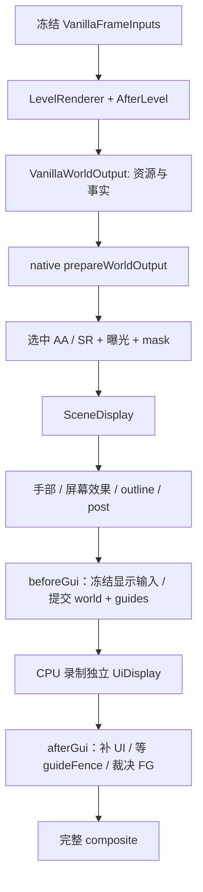

# 超分辨率（Super Resolution）总览

超分把世界层从渲染尺寸重建到显示尺寸，GUI 始终以显示尺寸单独绘制。DLSS/DLAA 专项见 [dlss.md](dlss.md)；配置的唯一契约见 [渲染配置](../rendering/render-configuration.md)。

## 配置与资源归属

`SuperResolution` 和 `DeepLearningSuperSampling` 负责设置入口、偏好与状态展示。它们通过 `RenderConfiguration.request` 更新 requested；实际 provider 和世界附件由 `PreparedRenderConfiguration` 准备，并在组合 Commit 后发布 applied。同尺寸准备失败保留原配置；主菜单等待世界返回 AwaitingWorld，结束 UI 回调并保留 requested/pending。save 统一读取 settingsToSave 的 persistent，临时 resize 配置不覆盖磁盘偏好。

| 所有者 | 职责 |
| --- | --- |
| `RenderConfiguration` | 唯一 requested/applied、配置归一化与版本 |
| `PreparedRenderConfiguration` | 候选世界附件、真实 provider 准备、组合 Commit/Abort |
| `VanillaWorldOutput` | 分配并保活输出/曝光资源，提交世界颜色、深度、运动和来源事实 |
| native `prepareWorldOutput` | SR 选帧、AA、曝光、mask、PreparedFrame 发布、evaluate 与 SceneDisplay 输出 |
| native SR adapter | SDK 私有参数、历史、资源状态和 provider 生命周期 |
| `ReconstructionTiming` | 独立 CPU/GPU 计时资源与采样 |

JVM 不逐帧选择 SDK pass，不拼装每家 SDK 的参数，也不持有并行的重建历史。DLSS、FSR、XeSS 都从同一原生世界输出入口执行。

## 尺寸与质量

| 尺寸 | 含义 |
| --- | --- |
| render | 世界颜色附件实际尺寸 |
| display | SceneDisplay、GUI 与最终显示尺寸 |
| scale | 世界尺寸相对显示尺寸的百分比 |

普通比例、DLSS 比例和质量偏好保存在配置值中，实际世界附件在候选发布时替换。DLAA 使用 100%；FSR/XeSS 的 Native AA 同样保留独立输入和输出。比例修改与 resize 都走候选流程；小窗口按 caps 最小输入抬高 Applied.renderScalePercent，保存的质量档位保持原值。resize 尚未 ready 时先发布新尺寸的临时 NONE 配置；同尺寸 SDK 拒绝后暂停自动重试，细节见配置契约。

| 后端枚举 | id | 质量比例 |
| --- | --- | --- |
| NONE | 0 | 普通比例 25..400% |
| DLSS | 1 | Ultra Performance 34%、Performance 50%、Balanced 59%、Quality 67%；DLAA 100% |
| FSR | 2 | 34%、50%、59%、67%、Native AA 100% |
| XESS | 3 | 34%、50%、59%、67%、Native AA 100% |

能力由 native `querySrCaps` 返回，包括可用性、尺寸范围和支持的 mask。准备阶段校验实际尺寸，不能用修改 UI 值替代 provider 准备。FSR/XeSS jitter 相位数由 native 按真实输入/输出宽度查询并随候选发布。

## 一帧的数据流

重建在第一人称手部和晚期效果之前完成；世界 PreparedFrame 使用同一个冻结身份、真实世界深度与成功录制的 motion。native 校验 previous、镜头元数据和输入资源，统一决定本帧使用 TAA/SR 或保留普通颜色输出。缺少相容 previous 时不伪造历史。

世界颜色和已捕获深度不能在 GUI 前重新从已清空的主深度拼装。JVM `VanillaWorldOutput` 记录 velocity 并传递资源绑定，native 一次完成 PreparedFrame 发布、实际 evaluate 与输出。DLSS 通过统一 SR registry 执行；结果先写入 WorldOutput 拥有的独立显示尺寸纹理，再转入 SceneDisplay。DLSS 后置锐化保留在这次转入中。

SR/TAA 的 depth/motion 由 `ReconstructionFrameInputs` 封闭为同源 pair，world-output 和 provider masks 共用。OIT 业务捕获真实云候选与普通贡献，无普通贡献冲突且云 previous 有效时选择云 pair；其他像素保留 capturedDepth/baseVelocity。完整输入、coverage 与混合来源边界见 [云/OIT 接线](../rendering/work-graph-implementation.md#云oit-输入调查2026-11-15)。

native 只在重建成功后推进历史。世界、资源/配置版本、historyGeneration、真实帧连续性以及相机位移超过 64 格或转角超过 90°会使历史失效。输入和输出由命令录制租约保活，关闭请求不能代替 GPU fence 完成。

## Provider mask V2

`D3D12SrMask` 为世界输出提供当前颜色、深度、motion、previous 身份、jitter 差和 current→previous 映射；FSR/XeSS 按需采集 OIT 两张系数附件。实际分类与历史纹理由 native frameprep 拥有。OIT 来源按真实帧与资源版本匹配，没有 OIT 时仍可用相容颜色/深度历史识别变化。

| 输出 | 使用者 | 当前语义 |
| --- | --- | --- |
| reactive | FSR | 综合透明贡献和重投影颜色变化，降低不可信历史权重 |
| composition | FSR | OIT 的透明/合成贡献；只有两张真实 OIT 来源时发布 |
| responsive | XeSS | 结合透明、颜色变化及历史不相容的响应区域 |

各家 mask 使用独立语义。输出 flags 为 reactive=1、composition=2、responsive=4；它们与 SR capability bits 分开解释。DLSS 当前模型不支持该次尝试使用的 current-color bias，接线已撤销，见 [ABI12 实施记录](../rendering/work-graph-implementation.md#abi12-dlaa-局部历史拒绝)。

V2 保留 FSR/XeSS 的颜色和深度历史、真实像素 motion 以及去遮挡判断。历史须匹配 worldEpoch、configVersion、resourceVersion、紧邻真实帧、historyGeneration、尺寸和格式，并确认前帧已实际提交。缺失历史时按当前 availability 处理。生产路径没有 mask 均值/峰值 CPU 读回。

mask 改善重建历史权重，FG 仍要求完整运动来源。天空/天体、混合贡献与未知 post 的支持边界集中见[实施记录](../rendering/work-graph-implementation.md#abi10-运动来源与像素贡献)；来源不足时跳过本帧 FG，普通帧继续绘制。

## 与 AA、FG 和显示的关系

配置归一化保证 TAA 与时间性 SR 不重复消费世界历史；DLAA 选择 DLSS 且强制 100%，DLSS-G 同样要求 DLSS。所有互斥与比例规则集中在配置 owner，不通过跨门面锁 setter 或每帧补推维持。

世界 PreparedFrame 只服务世界 AA/SR；显示输入在 GUI 前 Prepare 冻结并提交 guides，GUI 完成后 Submit 只补 UI/backdrop，等待准确 guide fence、通过有效性裁决后才接受 FG SDK。SceneDisplay、UiDisplay、完整 composite 各有独立角色；100% 与无 SR 也沿用同一顺序。普通 SR 的 Streamline viewport 来自成功发布的候选槽位 2..4，FG 使用 viewport1。

显示 Prepare/Submit 两阶段已接线，最终阶段仍等待并回读同帧 validity 汇总，协议见 [FFM ABI](../misc/ffm-abi.md)。配套构建、实际运行、性能与 resize 后退出确认集中见[实施记录](../rendering/work-graph-implementation.md#当前构建与运行)。

## 计时资源生命周期

`render.reconstruction.ReconstructionTiming` 独占 timestamp query pool、GPU 样本与 CPU 成本采样。停止或切换 SR 只重置采样，查询池保留到所属 command context 成功等待 fence、销毁后释放。

计时组件在首次创建查询池前向唯一 encoder 实例登记 `AutoCloseable`。共享与一次性 encoder 使用相同完成顺序；fence 超时保留资源，不提前释放查询堆。完整批次按 120 帧读回，CPU 保留 128 个样本、每 120 帧报告一次。

## 文件导航

路径相对 `src/main/kotlin/io/github/dxegp/`。

| 文件 | 职责 |
| --- | --- |
| `render/config/RenderConfiguration.kt` | requested/applied、归一化和发布 |
| `render/config/PreparedRenderConfiguration.kt` | 真实候选与 native Prepare/Commit/Abort |
| `render/frame/vanilla/VanillaWorldOutput.kt` | 世界输出资源和事实提交 |
| `render/reconstruction/SuperResolution.kt` | SR 设置入口与状态 |
| `render/reconstruction/dlss/DLSS.kt` | DLSS/DLAA 设置入口 |
| `render/reconstruction/D3D12SrMask.kt` | OIT 捕获和 V2 mask 事实 |
| `render/reconstruction/ReconstructionFrameInputs.kt` | 捕获的世界深度 |
| `render/reconstruction/ReconstructionTiming.kt` | 计时池与采样 |
| `render/presentation/D3D12SceneDisplay.kt` | 世界输出和晚期场景目标 |

native 对应 `src/render/vanilla/d3d12_vanilla_frame.cpp`、`src/render/frameprep/d3d12_frameprep.cpp` 与 `src/render/reconstruction/`。
