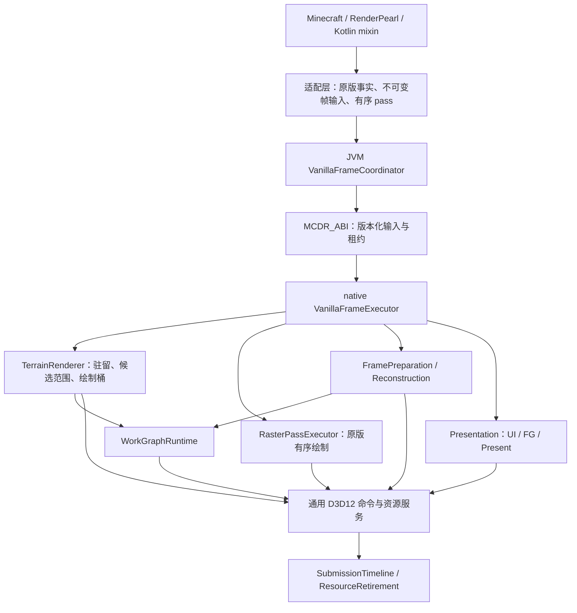
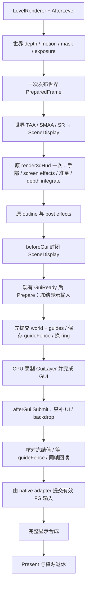
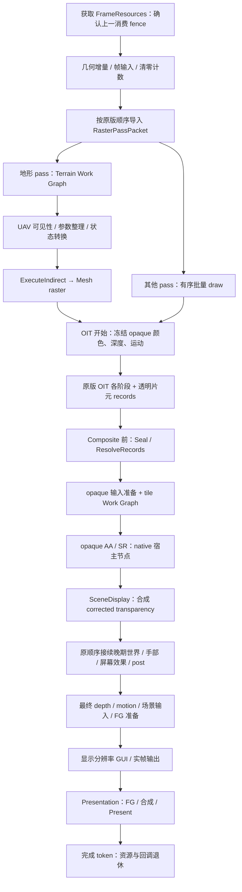

# 原版光栅路径：Work Graph 架构优化方案

状态：实施中；本页保留完整目标契约。范围是现有 Minecraft / RenderPearl 的 D3D12 光栅路径、mesh、AA/SR 与呈现，不包含光追、降噪器、辐射缓存和世界输运。
现状与缺陷证据见 [原版 D3D12 架构审查](../docs/misc/vanilla-d3d12-architecture.md)。本页规定重构后的职责和执行契约，不将这些能力描述为当前已经实现。

当前 TRANSMITTANCE tile 接线已推进到 shader 生产验证、JVM 16/32/64 mesh route 消费和 native root/signature/lease 注册；四 lane stage/depth 录制、精确内容冻结、GPU 分桶和最终 executor 仍是明确的未交付项。任何缺口都继续走 typed unavailable 并保留原版透明颜色。

## 1. 确定的工程决策

1. native `VanillaFrameExecutor` 管理帧内依赖、资源状态和执行；GPU Work Graph 管理局部、数据驱动的工作扩展。两者分别解决帧调度和 GPU 工作分发。
2. 地形使用 **compute Work Graph → 可见 meshlet 列表 → 参数整理 → ExecuteIndirect / DispatchMesh**。选用 Work Graph Tier 1.0 的能力集合；此架构不依赖 graphics/mesh nodes 扩展。
3. 保留现有 meshlet atlas、几何 owner、实际 draw 快照与重建输入/历史抽象；移除 CPU 每帧逐 meshlet 展开工作项的职责。静态数据按增量上传，帧输入按 section/instance 范围提交。
4. 所有原版 pass 经过显式的顺序和资源契约。只有已知语义的地形段交给地形调度器；实体、手持物、粒子和 GUI 的原版着色与顺序由批量命令路径承接。
5. 本方案使用一条 DIRECT queue 执行光栅、Work Graph、普通 compute 和 SDK 命令；提交线程负责录制结果的提交与呈现交接。不开设额外 async-compute/copy queue，不以旧 bundle 子系统为核心。
6. 先统一 submission/fence 与资源寿命，再接入 GPU 工作分发。不得让 Work Graph 继承当前 UBO 回绕、描述符误复用或超时后继续访问 context 的缺口。
7. Kotlin 继续作为 JVM 业务与 mixin 的首选；`MCDR_ABI` 保持唯一 FFM 出口。SDK context、descriptor、GPU 地址和图内部记录均归 native。
8. 所选配置缺少必需能力时明确拒绝启用；配置发布采用帧边界事务。既有生效配置的保留属于事务失败语义，不得报告新配置已生效。

Work Graph 不会减少 Minecraft 的 Java 场景提取、区块网格构建或 mod 回调成本；批量 ABI、增量驻留与采集粒度调整分别处理这些边界上的开销。

## 2. API 与编译边界

| 项目 | 本方案的确定做法 |
| --- | --- |
| Work Graph 能力 | 查询 `D3D12_FEATURE_D3D12_OPTIONS21.WorkGraphsTier`，要求至少 Tier 1.0；不能用厂商、SM 版本或 FL 标签推断支持 |
| mesh 能力 | 独立查询 mesh shader tier；Work Graph 支持不自动代表 mesh shader 支持 |
| 编译目标 | 复用当前 SM6.9 / Agility 装载体系；内置节点使用原生 HLSL，由 DXC 编译为 `lib_6_9`，另行验证 node 编译及 state object 创建 |
| SM6.9 定位 | WG 基础 API 来自 SM6.8；当前源码的图形编译已要求 6.9，本方案沿用现状，但能力目录分别记录 WG、mesh、6.9 与各 SDK 需求 |
| CoopVec | 作为独立能力和编译需求登记；本次没有自有神经网络计算，不为“使用 6.9”向剔除/压缩流程添加网络。SR SDK 的内部模型仍由 SDK 执行 |
| shader 服务 | 原版 GLSL 经 naga → HLSL → DXC；内置 HLSL/node 直接进入统一 manifest/布局校验与 DXC 服务，无需先反向送入 naga |
| 图运行 | `CreateStateObject`、`ID3D12WorkGraphProperties`、program identifier、`SetProgram`、`DispatchGraph` 封装在 native `WorkGraphRuntime` |
| GPU 入口 | 通过 `DispatchGraph` 的 GPU-input 模式消费 GPU 记录；不能把 `DispatchGraph` 当成已支持的 `ExecuteIndirect` argument type |
| 光栅出口 | WG 写可见表和计数；整理参数后以 `ExecuteIndirect` 的 `DISPATCH_MESH` argument 消费，PSO、RTV/DSV、root layout 由宿主绑定 |
| SDK 边界 | DLSS/FSR/XeSS、FG SDK 调用属于 native 帧图中的宿主录制节点，GPU node 不能调用 C/C++ SDK 或 Present |

Microsoft 的基础 Work Graph 规范与 mesh nodes 预览资料具有不同的能力/发布条件。本方案选择 compute WG 与标准间接 mesh 绘制的组合，按该组合完成工程，不依赖 mesh nodes 普遍可用的假设。
WG 使用 `D3D12_STATE_OBJECT_TYPE_EXECUTABLE`；使用 state object 不要求引入 DXR、BLAS 或 TLAS。
`lib_6_9` 编译器、实际 Agility core、驱动、WG tier、mesh tier、节点状态对象创建结果分别记录到启动诊断。源码当前选择 Agility 619；打包与调试层必须使用匹配的运行库，不能仅根据编译时头文件宣布运行时支持。

编译入口抽象为产出 manifest、BindingLayout、NodeRecordSchema、所需能力和工具链指纹的服务。naga/DXC 细节不进入帧协议；既定 Zig processor 完成后替换编译 provider，不修改业务输入和 WG 运行契约，也不增加 SPIRV-Cross 回退。

## 3. 业务模块与依赖

| 模块 / 建议目录 | 拥有状态与输出 | 依赖约束 |
| --- | --- | --- |
| JVM `render/frame/vanilla` | `VanillaFrameCoordinator`、真实帧号、采集阶段、帧资源租约 | 调用版本化 native 会话，不执行 SDK 内部 pass |
| JVM `render/terrain/mesh` | 现有几何 owner、不可变几何增量、实际 draw 快照 | 不拥有 GPU 驻留排序，不逐 meshlet 构建每帧工作表 |
| JVM Minecraft 适配层 | 将原版 pipeline/pass 转成 `PassRole`、`PipelineSemantic`、`OrderPolicy` | 名称/usage 识别集中于适配边界，通用 D3D12 层不得猜业务 |
| native `render/vanilla` | `VanillaFrameExecutor`、帧拓扑、pass 导入与业务调度 | 依赖各业务描述和后端服务，不暴露全局可变 frame manager |
| native `render/terrain` | `TerrainRenderer`、GPU 驻留、meshlet 范围、分桶、可见表 | 使用 WG/命令服务，不管理交换链或 SR 历史 |
| native `render/frameprep` | 运动/深度/掩码准备、tile 分类、VRS 生成 | 交付完整输入和明确版本，不推进 SDK 历史 |
| native `render/reconstruction` | AA/SR 组合、算法历史、provider context | 不自行取交换链、递增帧号或调用 Present |
| native `render/presentation` | 世界/UI 合成、FG、pacing、真实帧与显示帧关联 | 唯一呈现 owner，SDK 交换链 hook 也归它管理 |
| native `backend/workgraph` | state object、program、节点记录布局、backing memory 实例 | 不含 Minecraft 名称、材质语义或 SR provider 选择 |
| native `backend/command`、`binding`、`resource`、`submission` | 命令、subresource 状态、绑定页、分配器、提交与退休 | 不反向引用 render；按实例持有状态，禁止拆文件后仍共同修改全部 `gCtx` |

`D3D12Device`、encoder 和 `RenderPassBackend` 承担通用 SPI 职责。encoder 已通过构造注入的录制会话确认实际投影上传、开始/结束 raster 声明和创建 pass；pass 由业务 policy 选择地形路径、准备 motion 数据及包住 VRS 作用域，实际绑定、批量 FFM 和 PSO 恢复仍由后端执行。每个会话拥有地形驻留和 pipeline 分类缓存，command context 完成并销毁后才释放。

`MCDR_ABI` 已移除配置读取；已有计时由 `diagnostics.RenderProfiling` 管理。Backend 组合 `VanillaPipelineCompiler`、变体编译器与录制工厂，提交模式从配置转成设备中立枚举。设备通过 `D3D12PipelineCompiler` 委托编译，pipeline 产物只持有并关闭变体；地形/motion/宽线规则归业务编译层。`checkD3D12Dependencies` 在编译前检查 device、command、编译产物/转换缓存和 FFM 核心，拒绝其直接依赖 render/config；唯一 FFM 出口保持不变。

Kotlin 热路径明确选择内联编码作用域和 staging writer，分配器与业务编排保持普通函数。FFM 按实际目标大小和布局分配，小数组有界复用，大数组使用调用内 arena；GPU 上传沿实际 fence 退休。大小、对齐、空数组与释放规则统一见 [FFM ABI](../docs/misc/ffm-abi.md#24-数组与结构体数组)，各业务不能另建无上限的临时内存缓存。

## 4. 跨模块输入契约

配置统一使用 [requested → prepared → applied 契约](../docs/rendering/render-configuration.md)。RenderConfiguration 拥有 requested、applied 和 persistent；PreparedRenderConfiguration 真实创建候选世界附件和 provider，按 FG Prepare → SR Prepare → 组合 Commit → 世界附件发布推进。完整 Published 才更新 persistent，save 读取 settingsToSave；同尺寸失败保留旧配置。主菜单等待世界返回 AwaitingWorld，结束 UI 回调并保留 requested/pending；resize 先确保新尺寸的临时 NONE 配置可渲染，同尺寸 SDK 拒绝后暂停自动重试。小窗口可抬高实际输入比例，用户存储的质量档位保持原值。

以下名称是目标类型，不表示已有导出函数。

| 类型 | 必需内容 | 所有权 / 有效期 |
| --- | --- | --- |
| `VanillaFrameInputs` | schemaVersion、worldEpoch、realFrameId、原点、current/previous 相机、jitter、曝光、尺寸、配置/资源版本 | JVM 冻结，native 校验后复制值；异步引用数据显式保活 |
| `GeometryDelta` | owner identity、generation、layer、顶点/索引与 meshlet 范围、边界、materialVersion、创建/替换/退休事件 | 复用当前 owner；按稳定身份更新 native 驻留，拒绝过期世界/版本 |
| `RasterPassPacket` | pass identity、原始序号、附件/访问、viewport/scissor、整数 BindingLayout、pipeline key、draw 范围、排序语义 | 一个批次跨 FFM，不传 MC 对象、SDK descriptor 或可变 manager |
| `TerrainCandidateSpan` | 冻结 draw 的 owner/version、顶点切片、section/instance、meshlet start/count、绘制桶 key、原始顺序号 | 帧级紧凑候选，驻留对象由本帧租约保活 |
| `PassResourceUse` | resource/version、subresource、读写类型、所需状态、外部调用后的状态/缓存失效范围 | native 编译资源依赖和 barrier，未知副作用是硬批次边界 |
| `SubmissionToken` | device generation、queue/context identity、submission serial、所属 fence identity/value | native 生成；不同 fence 数值不互换，CPU 握手与 GPU 完成分开 |
| `PreparedFrame` | 世界颜色、深度、真实运动、曝光、reactive/composition、输入有效性、realFrameId、完成依赖 | 重建消费；UI 和生成帧不写入世界历史 |

帧输入由现有 `VanillaFrameCoordinator` 与 native context 共同持有，确定拆为两个有序不可变值：世界绘制前冻结 `VanillaFrameInputs`，真实深度/运动/曝光/掩码命令录制完成后一次发布 `PreparedFrame`。两者共享同一 identity/historyGeneration；不能把尚未产生的纹理填进一个随后继续修改的“快照”。GPU 输入就绪由实际命令依赖保证，发布不意味着 fence 已完成。

统一帧输入按以下契约实施：

1. `realFrameId` 保持单调且只标识真实世界帧；`historyGeneration` 撤销相容历史，jitter phase 只选择当前采样。三者不与 Present 次数混用。`D3D12Temporal` 保持唯一 jitter 生成者，冻结实际上传的未抖动投影、实际注入的像素 jitter、权威 camera render state 的旋转和 double 原点；不得从 GUI/hand 上传或 chunk 回补数据推测世界相机。
2. current camera 必须真实可用；首帧或不相容 previous camera 使用明确的 history-invalid/reset 语义。旋转/投影矩阵为列主序，原点差先以 double 计算再转换 GPU 矩阵；不建立 float 绝对世界 view。Kotlin 数组在冻结时复制并封装，调用者不能修改快照内容。
3. 世界/显示尺寸取实际已分配附件，配置取本帧成功生效的语义值。frame input 同时携带 world/config/resource 版本、historyGeneration、frame time/delta、current/previous camera、jitter、深度与颜色约定和 preExposure。SDK 的行列主序、jitter Y 翻转和颜色转换只在对应 adapter 做一次。
4. `PreparedFrame` 在选定重建入口前完成实际 depth/velocity、mask 和 exposure 生产后发布一次；每项资源携带真实范围和 availability，未选择的资源不伪称有效。TAA/off 路径声明其实际输入集合。现有生产者持有资源，native 接收时固定 wrapper/view/source 与 recording 租约；provider 的异步保留沿用已建立的提交/fence owner。
5. velocity、raster motion、VRS、TAA、统一 SR、旧 DLSS 与 FG 的常量全部由这两个值构建，移除各处再次读取 Minecraft camera/window、Temporal getters 和运行中设置来重建同帧事实的做法。native SDK pass 执行、历史与私有 scratch 继续属于业务 adapter，JVM 不接管 SDK pass。
6. 世界录制完成只保存 recorded 候选；相机、OIT 与 viewmodel 的 presented previous 在真实 Present 成功回执后发布，下一帧冻结投影和应用配置前完成结算。provider 评价历史仍由该 provider 成功结果推进。abort 撤销尚未发布的产物并使下一帧 previous 不相容；reset/Present 清除帧值时不提前释放仍在消费的 recording/submission 租约。UI、生成帧和无世界帧不推进世界历史；超时与提交未知保留 owner，不消费未结算回执。
7. 替换现有 48 字节 identity-only 参数时同时发布 schema 2 与 ABI8，登记实际 C/FFM 大小、偏移和 inline 数组；native 同步复制宿主数据，跨模块只用 opaque pointer/scalar。begin/world-ready/gui-ready、PreparedFrame 发布及各生产/消费方在同一次迁移中配套，不保留旧 schema 的隐式回退。

FG 稳定原点与历史回执由现有 native FG 业务持有，明确区分待接受的真实帧与成功历史。缓存 constants 只表示接收了 CPU 参数；SDK constants/resource tag、enable、命令提交和实际 Present 的结果共同推进对应状态。原点在连续相容历史中固定；disable、无世界、resize、context/chain 更换、abort 或失败使下一有效帧必须 reset，已录制资源继续由实际 fence 租约保活。XeSS 的 present ID、constants tag 与 enable 返回值必须传播；FSR-FG 将统一 reset 原因合入既有 reset latch，成功 Prepare 后才清除。普通帧 metadata reset 与历史失效分别处理，避免每个 Present 都重置 FG 历史。

实际时序已核对：Minecraft.renderFrame HEAD 记录帧开始时间，window configure 后，beginDisplayFrame 先按本帧窗口 resize 原版目标，再应用配置并开始 native display frame。后续投影上传使用已发布的尺寸和配置计算 jitter，包含 hurt/bob/nausea 的实际世界投影成功上传后才进入 LevelRenderer.render；CPU 几何准备和天空绘制早于 main-pass lambda。统一帧值在外层 render HEAD、几何捕获前冻结，使用实际 camera state 和成功上传的 level projection；冻结后即启动 native world frame 并登记清理 raw motion 附件，天空纳入同一帧的资源声明。main-pass HEAD 验证附件并推进已有帧的阶段。上传成功记录由完整写入路径确认，世界/尺寸/来源时间必须与本帧相符。

jitter 的矩阵规则固定为 `Pj = Tclip(2*jx/W, 2*jy/H) * P`，保留实际变换后的投影与深度约定。上传、velocity 和 VRS 已共用该计算。raster predecessor 在外层 `LevelRenderer.render` 成功返回后提交；该方法的几何准备、天空、main-pass 和后续清理异常均撤销当前帧候选，下一帧 previous 失效。provider 历史仍按各自成功评价提交。

完整帧与 `PreparedFrame` 已按 schema2/ABI8 同时接入 C、FFM、native owner 和实际消费者。准备入口仅发布一次真实输入，native 构造 TAA/SR/DLSS/FG 私有参数；原独立每帧 SDK 入口、JVM 相机常量和并行布局已删除。FG 由 native 保存 pending、SDK 已接受和实际 Present 成功的历史；包装型 FG 在新输入准备前结算上一 Present，保持相机与输入资源对应。

### 4.1 世界、第一人称与最终场景

世界重建已经移到 `AfterLevel` 完成后、原 `render3dHud` 调用前；main-pass 返回只保存寿命短的 OIT 产物。JVM VanillaWorldOutput 分配资源并提交颜色、捕获深度、运动与来源事实，native prepareWorldOutput 统一选帧、AA、曝光、mask、evaluate、DLSS 后置锐化和 SceneDisplay 输出。raster predecessor 只在最终世界调用成功后提交，`LevelRenderer`、`AfterLevel` 或后续帧失败均撤销候选历史。

| 资源角色 | 固定职责 | 生产/消费边界 |
| --- | --- | --- |
| `WorldRender` | 渲染分辨率世界颜色、世界相机深度与运动 | LevelRenderer 与 AfterLevel 完成后封闭，供世界 AA/SR；手部和 post 不再写入 |
| `SceneDisplay` | 显示分辨率的完整场景颜色与原版 post 所需 scene depth | 接收世界重建结果，依原顺序绘制手部、屏幕效果、准星、outline 和 post；GUI 前封闭 |
| `ViewmodelInputs` | 独立 HUD 投影、实际 depth、coverage、current/previous motion 与来源身份 | 原 first-person submit→prepare→draw 一次采集，按真实 HUD clip 空间计算；与世界相机分开 |
| `GuiLayer` | 显示分辨率的真正 GUI | SceneDisplay 完成后开始；hudless FG 合成时独立提供 |

实际目标路由覆盖 `renderItemInHand`、`render3dHud`、depth integrate、outline 和 post 的字段读取及显式目标参数；只改一个 accessor 会漏掉直接读取 `mainRenderTarget` 的原版调用。HUD 保留自己的真实投影上传和原绘制顺序，直接混合到 SceneDisplay，透明手部继续读取实际世界背景。禁止重画一遍手部补颜色，禁止以世界重投影代替手部 previous。原版 post 的 scene depth 与 FG 的投影/覆盖 guide 使用不同字段，世界深度到显示尺寸的映射记录实际采样规则。

新增不可变 `DisplayFrameInputs`，携带与世界相同的 identity/historyGeneration、scene/resource/viewport 版本、最终 scene color、显示尺寸、各层 depth/coverage/motion、真实 current/previous 投影和 post 变换契约。第一人称、屏幕效果、outline、透明混合与 custom 来源分别拥有 provenance；数据缺失表达为具体 availability。SDK adapter 从这些真实事实构造所需格式和深度/运动约定，不能把混合 HUD depth 直接标成世界深度，也不能把零 motion 伪报成真实 guide。

世界重建发布一次，显示输入按 GUI 前 Prepare、GUI 后 Submit 两阶段接线。SR evaluate 与 DLSS evaluate 中的两处 FG 自动 tag 已移除；最终场景在 post 完成、GUI 前封闭，FG 在 GUI 完成后接收最终场景与实际 UI，同一帧禁止再次推进 pendingCamera。SDK 接受、提交和实际 Present 成功继续分别记录，生成帧不成为世界或 viewmodel 前驱。当前源码 ABI 和新增 OIT 描述见 [FFM ABI](../docs/misc/ffm-abi.md)；显示与世界输入继续使用 schema2，显示帧 672 字节，mesh 描述符保留显式 raw MRT 标记，大小为 104 字节。

FG 同帧提前提交已接线：`beforeGui` 在现有 GuiReady 后 Prepare，native 深复制 scene/layers/posts/cameras，先提交 world + guides、保存准确 `guideFence` 并换 ring，CPU 随后录制 GUI；`afterGui` Submit 只补 UI/backdrop，核对冻结值并等待同帧 guide 结果，有效性通过后才接受 SDK。中间提交不创建最终 Present ticket，输入/输出及描述符租约跨阶段保留。世界与手部分别提供独立 R8 coverage，SR/AA 继续只读有限值 RG16F motion。等待缩短和吞吐收益尚未测量。

SceneDisplay 在异步 FG 消费期间保持内容稳定，GUI 使用独立目标；wrapper 保活与纹理内容不再被覆盖分别由资源租约及轮转/完成依赖保证。resize、world/config/source/history 变化同时撤销未提交的世界和 display 候选。100% 和无 SR 也使用相同角色与顺序，缺失必需资源或已选能力的输入协议时通过明确错误通道报告，不添加隐式旧路径。

绘制桶包含 layer、pipeline/PSO、binding layout、资源绑定版本、附件、VRS 和 mesh 变体；材质 ID 不足以判断两个 draw 可以合并。
pipeline 编译时生成整数绑定槽和 root constants 布局，draw 热路径复用编码区，消除字符串查找与六组平行临时数组。
批次必须覆盖实际 SPI 的各个 `multiDrawIndexed`/`multiDraw` 重载；不支持的布局在 pipeline 创建时拒绝，不能忽略 `pushConstants`。

motion 不拆散原有批次：同一 PSO/布局的连续 draw 共享一次准备，逐项保留自己的参数与真实 sidecar slice，按原序一次跨 FFM；native 在批次内使用各项绑定录制 draw。中性 guide 沿用相同批量出口，不能通过关闭 motion 或复用第一项 baseVertex 恢复批量。普通 draw 的所有实际读取需要纳入资源 use manifest，attachment 父 token 不能代替 CBV/SRV/IA/indirect 输入声明。

普通光栅输入采用 **native 实际绑定快照**：device 记录成功设置的完整 CBV/SRV、有效 VB 槽与 IB；纹理 view 保存创建时的真实 SRV 描述。`abi_draw` 在实际 direct/bulk/indirect 消费边界接入 vanilla 调度，复用所属 attachment token 冻结的资源版本。device 不反向导入 vanilla，JVM 不为每个 draw 重建资源列表或增加声明 downcall。正常与 motion 两种 `BindingPacket` 接收相同的来源更新和删除，reserved motion 参数仍逐 draw 覆盖。

该项交付按以下依赖整体实施：

1. 保留真实 SRV 的 mip/layer/plane 范围，并同步收窄 attachment 声明与实际 transition；不从纹理总层数推造 view 范围。buffer 调度粒度保持实际 subresource 0，同资源 CBV/VB/IB/SRV/indirect 的兼容读状态先合并。
2. binding 快照与 root layout、成功的设置操作及录制租约绑定；root signature、外部图形/descriptor 副作用、bundle 和 command-list reset 按实际影响撤销快照，IA 状态按真实硬件语义保留或失效。
3. direct/indirect 在实际消费处导入；bulk 冻结共享输入和所有逐项 motion overrides 的并集，native 内部后续绑定不能收窄该并集所需的读状态。保持原序与批量 FFM；间接命令声明实际 `INDIRECT_ARGUMENT` 读取，不回读或猜测顶点范围。
4. 调度器按 context、实际 resource 与 subresource 保存访问前沿并合并重复只读访问；不追加逐 draw 的完整历史与长生命周期 token，也不对每个 draw 扫描本帧全部旧 uses。资源保活继续服从实际 recording/fence。
5. 在 SRV transition 前拒绝与实际 color/depth/motion attachment 重叠；UPLOAD 保持 `GENERIC_READ`，READBACK 不能作为 draw 读取。terrain/SDK 已有声明保留其 owner；生产拒绝通过既有错误出口终止本次录制，不重放已录 draw。

普通输入导入已按这些约束接入；完整帧业务所有权、所有资源布局和性能仍按各自实际证据记录。

动态视觉验证由用户观察具体场景的拖影、闪烁、轮廓残影和稳定性；代理提交已构建产物、观察项及可量化证据，静态截图不作为动态画质验收。必要的验证实现与生产模块隔离，不新增启动行为自检或验收专用业务分支。

原版 FrameGraph 决定的顺序作为输入保留。按实际 pass 分段提交：world-ready 在已知深度清除前产生快照，world-post 在 UI 前完成命令录制；不能等到 Present 才重放已经失效的资源。
同步读取、资源映射、附件变化、第三方录制或不可声明的副作用均结算批次并建立明确边界。批量 FFM 不要求整帧只能一次 downcall。

## 5. 帧执行与 Work Graph 内容

### 5.1 帧级顺序

地形与普通 draw 是不同 pass 的执行方式，不授予它们跨原版顺序任意并行的权限。一个 pass 内只合并状态兼容、允许合并的连续命令。

### 5.2 Terrain Work Graph

确定生产数据流：`SectionEntry → SectionCull → MeshletRange → MeshletCull → EmitVisible`。

JVM 从实际 MDI 批次生成每 section 40 字节的候选范围，复用批次的去重几何列表与静态 descriptor atlas；GPU 展开 meshlet 工作表并压紧可见记录。atlas 全部命中时复用已有驻留 buffer，初次驻留或几何变更仍上传对应静态数据。批次通过一次 native prepare 和一次 native draw 录制，JVM 不按 meshlet 或逐 draw 重建资源声明。

- `SectionEntry` 接收 section/instance 范围和驻留表索引，不重复复制 meshlet 描述符。CPU 输入量由 meshlet 数量转为候选 section/instance 数量。
- `SectionCull` 做保守视锥和合法边界检查；版本检查在宿主发布阶段完成，GPU 消费冻结的驻留版本。
- `MeshletRange` 以 broadcasting 范围记录扩展工作；不为每个 quad 创建节点记录。
- `MeshletCull` 沿用保守包围盒、方向掩码和相机数据。双面/非轴向和无界几何保留现有放行规则。
- `EmitVisible` 以 coalescing 收集最多 64 个存活项，每组一次领取连续 visible 槽位，写入原 descriptor/section 对；容量溢出设置错误位，由参数终结阶段禁用整批绘制。

三节点融合候选保存在 `src/probes/terrain_nodes/fused-candidate.hlsl`。它通过真实 GPU 输出检查，逐轮提交的均值更低，但单列表连续派发出现约 8.4 ms 长尾，dense/sparse 平均耗时升高。工程决定保留五节点生产图，融合候选不进入发布资源。

WG 承担细粒度剔除，后续 MS 消费压紧工作项，不重复运行同一套 AS 细剔除。复用 MS 顶点解码与 PS 输出，新增直接读取可见工作表的 MS 入口；16/32/64 变体仍由明确的 pipeline 配置选择。

WG 完成后由宿主 barrier 建立全局完成边界，再录制普通 compute `FinalizeTerrainArguments` 读取计数并生成间接参数。它与可见表之间具有明确 UAV/SRV/INDIRECT_ARGUMENT 状态转换；不能把“终结节点”当成所有其他节点都完成的全局 join。
native 按宿主已知的绘制桶绑定 PSO/附件/布局，再执行 indirect；GPU 不修改任意 PSO。大批次按 DispatchMesh 的维度及总线程组限制切片，参数槽按候选上界预留，计数留在 GPU，不逐帧读回 CPU 决定 draw 数。

native terrain owner 在 prepare/draw 内导入全部实际输入与私有 visible/arguments 输出；mesh 常规材质 CBV/SRV 与几何读取进入同一个 child 声明，继承附件父 token 和冻结资源版本。mesh descriptor 与 root signature 共用 binding 布局。wrapped/raw 资源共用 `PassResourceUse`，兼容只读用途按实际 resource/subresource 合并；UPLOAD 保持 `GENERIC_READ`，私有输出以 `COMMON` 为列表基准，实际状态只由 context tracker 拥有。batch、program、wrapper、raw resource 与绘制管线的租约保留到对应 fence 完成。

容量按候选最坏输出数预先计算；每个候选最多输出一次，节点 `MaxRecords`/dispatch grid 与运行时上界一致。显存预算不足在发布前报告错误；越界计数必须可诊断，不能截断后宣称正常完成。
当前候选来自实际 draw，WG 只能细分/剔除已提交候选，不能恢复原版已经排除的 section。此方案不新建全世界几何镜像，也不宣称消除了原版 CPU 可见性遍历。

### 5.3 遮挡和透明内容

- 基础剔除固定为视锥与方向，不为 HZB 强制增加一遍全世界深度预通过。
- pass 已有合法的本帧保守遮挡深度时，可在资源契约中启用 HZB 输入。HZB 由独立、带 mip 依赖的 compute 阶段构建，深度方向与保守归约由 `DepthConvention` 指定。
- 上帧 HZB 仅作排序/调度提示，不单独据此剔除当前帧几何；相机切换、原点、视口和投影变化撤销其有效性。未经证明的时域遮挡结果不能造成几何消失。
- 普通透明、原版排序索引以及 OIT 各 pass 保持已有顺序和混合语义。原子 append 的完成顺序不代表透明排序；透明进入有序批量绘制出口。需要剔除时只生成原顺序位置的可见标记并保序压缩，禁止复用不透明的无序可见队列。

### 5.4 帧输入与 tile Work Graph

帧准备分为完整输入准备和局部可变工作，共享统一 `FrameResources`：

1. 运动、深度、曝光和重建输入的尺寸/坐标转换以普通 compute 执行，保证每个目标像素有有效值。真实物体运动依赖 previous transform/变形信息，不能通过相机矩阵或 WG 自动补全。
2. `TileClassify` 按深度、运动、材质/透明标记和历史有效性分发 tile 记录；不同节点生成 reactive/composition 掩码、VRS 建议与诊断数据。只执行已选配置需要的输出节点。
3. 每个输出像素具有唯一写入 owner；空 tile 明确填入中性值，不依赖旧帧残留。SDK 专有掩码由 adapter 转换，不把不同 provider 的定义混成通用“置信度”。
4. 在 opaque AA/SR 完成、切换 SceneDisplay 前复制原 render 网格深度，作为下一真实帧开始时 VRS 工作图的历史输入。输入按相机、实际 raster jitter、camera-relative 原点差和版本映射到当前屏幕；缺少覆盖、深度断层和不收敛区域使用 1×1。候选历史与最终 SRI 分开保存，连续候选确认后才变粗；该屏幕空间估计不能证明历史未见表面的当前可见性。
5. AA/SR 保持单一配置组合，由宿主在输入准备完成后调用。UI 在世界重建后绘制；FG 消费真实帧，生成帧不推进模拟、jitter 或世界历史。

稠密整图卷积、全局归约、固定深度 mip 链、SDK 内部算法继续使用适合它们的 dispatch/SDK 接口。WG 用于数据决定工作量和分支的任务，不为了把所有 pass 都叫 node 而拆碎连续计算。

程序按编译 generation 预热并一次发布：曝光 meter/reduce PSO、设备支持的 mask/VRS 工作图和显示域 `DisplayFrameGuides` 均在首次消费前创建，包括当前配置未启用、可以动态启用的图。当前配置的能力要求在预热入口校验；新产物全部成功后才替换旧 owner，失败保留旧 owner。消费缺少所需预热产物时报告错误，录制租约保留旧产物到 fence 完成。

### 5.5 云与 OIT 的贡献输入

26.3.0.95 的普通 OIT 写原 `depthBounds`，云写 `depthBoundsCulled`，最终 composite 从原 bounds 的 `.b` 写 main depth。云颜色因此可能参与合成而 main depth 仍为零；当前 velocity 会把它当作无限远方向。云私有 DSV 在 DEPTH_BOUNDS 选最近实际云，ACCUMULATE 继续使用该 DSV。原 main color、main depth、透射和晚期效果的目标与顺序全部保留。

云 producer 在真实 ACCUMULATE 存活片元输出独立候选，沿用原 shader 的 fog、discard、遮挡和真实 RGB/alpha 贡献。普通 OIT 的真实贡献标记与候选 resolve 作为同一工作包接入，覆盖 additive 与零 alpha 的非零 RGB；`raw=-4`、原 bounds 为零或没有普通 nearest 均不能作为“只有云”的判据。逐像素来源、同源 previous 与贡献冲突由 OIT 业务拥有，device 只执行附件、绑定和资源命令。

来源从 `executeOit` 的实际 terrain、feature、border、weather、cloud 和扩展回调采集；每次 draw 对应真实 stage、颜色附件、DSV、Coeff、DepthBounds 与同帧身份。shader 认证与来源认证分别检查，复用原版云 shader 的第三方绘制不能自动获得云身份。pass 创建或绑定本身不产生贡献，空调用保持无贡献，实际未知 draw 才标记来源缺失。来源作用域和 pass 的异常、关闭、帧取消都由 OIT 业务统一退休，mixin 只转交调用与资源事实。

`ReconstructionFrameInputs` 拥有一份按 frame 封闭的 SR depth/motion pair；一次 resolve 选择同源 depth 与 motion，输出 D32_FLOAT DSV 和 RG16_FLOAT motion RTV，统一供 world-output 与 provider masks 使用。原 capturedDepth、普通 velocity 和 coverage 保持原角色，显示/FG 消费自己的层输入。云几何有有效 motion 时，混合颜色仍可能存在未覆盖来源；coverage 必须保留该冲突，不能因单个 producer 成功而声明整像素或整帧完整。完整多贡献记录包含来源、稳定 owner、current depth/previous clip、实际可见权重与 motion/遮挡冲突；新增公共消费者时版本化契约，不借现有 coverage 编码偷换语义。

云 previous position 使用真实 prepare 的 ticks/partialTick、纹理 generation 和连续滚动量，按纹理宽度对应的 400-tick 周期处理折返；不以模 12 的 CloudOffset 差或跨帧 face 出现次序配对。world/resource/history 变化撤销对应 previous。候选、resolve pair、原 SR 输入和 provider-mask 历史都绑定同一真实帧身份与录制租约，来源切换不得把旧表面历史套到新表面。

完整透明时域路径独立维护 opaque 与透明贡献的历史。OIT 之前冻结 opaque 的 color/depth/motion 供 SR 使用；透明记录保存原 fragment 最终写入 accumulate 的贡献 `q`，同时显式保存未加权材质、原 alpha、实际透射 `t`、当前 fog/chunk 参数、稳定 owner、previous clip/预期前深度及材质相位。`q/t` 在零透射、下溢和舍入时不可逆，禁止据此还原材质。地形的真实顺序是 chunkVisibility 混色 → accumulation sample → fog；fog 只改 RGB。additive 的累积 alpha 为零，原材质 alpha 和非零 RGB 贡献仍须保存。

逐 surface 历史稳定未加权材质，再用当前 alpha、透射、fog 和 chunk 参数重组贡献，禁止重投影上帧已加权颜色来继承旧遮挡。全部贡献使用原版全局透射与归一化系数，加法汇合后只对 opaque 合成一次；按类别分别执行 source-over 会改变原版颜色，禁止采用。透明轮廓 AA 还要求独立采集 TRANSMITTANCE 的真实 alpha/coverage 与 footprint，并从解析后的覆盖重建系数和透射；仅稳定 ACCUMULATE 的 RGB 不记为完整透明 AA。没有当帧贡献时不延续该贡献的历史，未知来源或记录溢出只拒绝相关历史，保留完整当帧颜色。SDK 的单 depth/MV 与掩码继续使用各自公开契约，多贡献历史不能压成平均或最近运动后宣称完整；这项输入能力与 SDK FG 的覆盖状态分别记录。

native 拥有有界 GPU records、逐像素索引、容量/overflow、资源租约与唯一 HLSL 布局；JVM 经 MCDR_ABI 提交不可变来源/primitive/previous 旁表，不计算 record stride 或上传 GPU 内部布局。capture 使用独立 `space2`，保留现有 `space0` 普通绑定与 `space1` push constants；普通、宽线、mesh/WG 的 PSO、root、预热和缓存同步版本化。逐像素记录阶段强制 1×1 着色率并恢复原 VRS 状态；仅在真实只读 DSV、固定覆盖规则、无自定义深度且保留原 discard 的认证路径使用 early depth。records 的写入和 resolve 通过现有 scheduler 声明 UAV 依赖；生产历史解析留在 GPU，不同步读回全图或逐帧写盘。容量预算覆盖当前记录、上一已呈现帧历史和所有在途租约，溢出不能覆盖旧记录或丢当前透明颜色。

opaque 与 final 运动复用 `D3D12Velocity` 的同一份投影数学，以显式阶段区分缓存和独立目标；早期 opaque 结果不能占用 final 的一次录制标记。世界输出 schema 3 用 `sourceStage` 区分完整世界与 Composite 前的 opaque；SeeThrough、AlwaysOnTop、AfterLevel 继续按真实顺序执行，禁止通过 final-minus-opaque 差色伪造晚期贡献。完整世界仍使用 COMPLETE_WORLD，OPAQUE_BEFORE_COMPOSITE 成功后才允许继续向 SceneDisplay 绘制透明和晚期内容。

主循环的接线位置按实际 26.3.0.95 固定：`LevelRenderer.executeOit` HEAD 位于 Solid pass 关闭之后，执行 `captureOpaque → Begin`；全部 producer 关闭后、原 Composite 创建前执行 `Seal → ResolveRecords → opaque AA/SR`。records 捕获作用域覆盖 terrain/features/weather/cloud/custom provider，不能在单个 provider 关闭时结束；cloud/weather/border 的 indexed draw、受支持 FEATURE 的 staged indexed draw 和 terrain Work Graph 已有认证捕获入口，其余实际 draw 写未记录覆盖。透明输入取原 Composite 实际绑定的 `targets.accumulate`，输出独立 RGBA16_FLOAT corrected transparency 与 R32_UINT status。原 Composite 保留完整 transmittance/normalization/additive 规则，按归一化坐标合成一次到 SceneDisplay。FrameGraph main 使用同一个借用附件的目标对象，切换后 Outline、SeeThrough、AlwaysOnTop 和 NeoForge AfterLevel 跟随 SceneDisplay；AlwaysOnTop 独立深度按显示尺寸创建。真正世界完成后在 `beforeDisplayScene` 生成 final depth/motion，不重复 AA/SR。

terrain 复用真实静态 VBO 与几何上传 generation，CPU 每批只交付有界 section 表。MS 用冻结的已呈现前帧投影和 double 原点生成 previous clip；禁止每帧在 CPU 展开逐三角形 previous，也不创建第二套顶点 atlas。surface 身份包含 world、producer、section 和 layer；材质包含真实 texture/view/sampler、mip 范围和成功上传/写入版本，纹理动画不能用 tick 代替版本。几何替换清除 geometry/material previous，材质变化仅清 material previous。翻转、无深度、未知来源和旁表容量拒绝保留真实当前颜色与未记录覆盖；错误和共享预算不足按帧失败契约处理。

实际 temporal 输出的 opaque depth 与透明 composite 从 display 采样 render 时使用 `(+jitterX,-jitterY)/renderExtent`；最终 display depth 回到 render 网格使用相反偏移。系数、bounds 与 corrected color 必须取同一个源 texel。晚期世界投影改用独立 uniform slice 中冻结的无抖 projection，世界完成或取消时恢复原 slice；首帧与 consumer 0 保留当前栅格投影和零偏移。VRS 在 SceneDisplay 切换前采集原 render 深度，不把显示网格冒充原 jittered raster。

雨雪 previous 使用实际 column 四角和真实随机返回值。纵向材质坐标为 `v(Y)=0.25*(bottomY+topY-Y)+vOffset`；反解前帧材质点时保留这个方向。131072 tick 折返会产生真实材质跳变，保留几何 previous 并拒绝材质历史；rain 的 `%32` 和 snow 的 512 tick 整数周期只有在实际 sampler 为 repeat 时才允许展开。云 owner 区分展开后的空间重复 cell、时间周期、face 与 inside/exterior 角色，纹理取模坐标或 draw 顺序不能充当稳定身份。

FEATURE 复用现有 model Key/cube、item Slot/stack/quads/topology 和 particle Lifetime/role/topology 的真实来源，沿 BufferBuilder → MeshData → ExecuteInfo 保留来源、UV0 和原 previous rows，不建立另一套 positions 镜像。实际 draw 的 VB、IB/type、stride、slice/baseVertex、index 范围和 topology 全部相符才使用 records；previous rows 的所属帧必须等于上一真实成功 Present 的世界帧。材质历史还必须匹配真实顶点 Color/UV1/UV2/Normal、CPU 上传的 ColorModulator/方向光和辅助纹理写入版本；按 profile/defines 选择实际使用字段，缺失或变化只撤销材质 previous，保留已认证的几何 previous。FEATURE shader 同时认证 fragment 与包含 helper 的完整展开 vertex 源码；原版 sorted quad IB 已从成功上传的实际索引建立映射，按真实 primitive 顺序重排 metadata，surface 身份保持原 source ordinal/triangle role。TextureMat/glint/dissolve、任意 custom IB、未知来源和多实例尚无完整对应。失效来源在 Resolve 前撤销历史资格；重复消费不重发原 draw，也不发布对应 surface 历史。

双面实体跨帧前后面翻转时，几何映射的有符号 Jacobian 必须保持正向且 quad 内 previous 完整，才允许复用材质颜色；相机绕面不能带入另一面的光照。UV0 跨帧变化时只在相关顶点着色均匀的三角形复用材质历史，避免 UV 反解改变 tint/lightmap 插值位置。

BORDER 复用真实成功上传的 16 个顶点、mesh generation、dynamic ModelView/TextureMat/offset/color 和实际毫秒相位。原版集合出口逐项调用 backend.drawIndexed，按真实 firstIndex 选择 side，保留原排序。3 秒 UV 周期只有在 sampler 为 repeat 且实际变换认证通过时展开。

ABI21 的真实 Present 历史回执、terrain records 与配套接线修正已进入生产循环；用户在 DLAA/M、FG 关闭、无采集的客户端确认固定残影消失。FEATURE/BORDER 的源码接线已完成，capture 缓存 schema 为 `/5`；JVM 完整构建和包检查已经通过。运行窗口仍保留此前 terrain 版本，因此新 `/5` capture、完整 vertex 闭包认证、terrain lightmap identity 和 legacy guide 延迟分配尚未获得实机动态确认。完整透明任务继续覆盖 TRANSMITTANCE alpha/coverage AA、未认证 FEATURE 来源和多贡献 FG guides。连续全图采集曾把帧率降到约 3 FPS，现有序列仅供离线分析，动态画质确认由用户在正常运行条件下完成。

未产生 records 的真实 ACCUMULATE draw 必须写独立 R8/MAX 覆盖图，按原 discard/depth 后存活的片元标记，包含 q 为零和 additive alpha 为零的片元。Resolve V3 将非零覆盖像素标为 unknown，保留完整当前 accumulate；若实际 draw 无法生成覆盖，提交明确的 UNAVAILABLE，整帧保留 unknown。空 draw、仅 setPipeline 或失败的 draw 事务不登记缺失；EMPTY 与零覆盖不能抵消已声明的 unknown。覆盖图按帧清零，归 OIT 域与原 encoder 所有，不用当前颜色或“记录数为零”猜测完整性。ABI19 已接入正常循环、材质 RGB 历史与分阶段世界输出；TRANSMITTANCE alpha/coverage AA 和未认证 producer 的完整 records 继续列为确定的实施项。

#### 5.5.1 四子样本 tile 流式覆盖

完整 alpha/coverage AA 固定采用 tile 流式执行，详细执行契约见 [TRANSMITTANCE 四子样本 tile 执行契约](../docs/rendering/transmittance-tile-execution.md)。每 tile 的四个当前子样本分别保存 bounds、coeff 和 Q，按真实 producer 顺序完成 DEPTH_BOUNDS → TRANSMITTANCE → ACCUMULATE，再各自执行原版 normalization/composite 数学，平均四个已归一化的透明结果。tile 完成后复用临时存储，不把整屏四子样本 fragment 塞进全局 records 池。当前 262144 条 records 在 4K 单层四子样本下仅覆盖约 0.79%，其职责限定为有界稀疏材质历史，容量不限制当前完整覆盖或 overdraw。

draw 输入由真实生产调用捕获：普通 IA 保留实际 VB/IB/instance，terrain 保留已生成的 WG visible/arguments、真实静态 VBO、globals/atlas 范围和 DISPATCH_MESH signature。packet 还保存原 producer/stage 序号、pipeline/root generation、绑定、push constants、viewport/scissor 和资源租约。原 draw 仍执行一次，tile 消费捕获的事实；不重新运行 Minecraft producer，不建第二套静态几何 atlas。

packet 的不可变字段和 COM 租约只固定绑定事实与对象寿命。允许延后 tile 消费之前，必须固定相关资源内容：UPLOAD slice 沿原提交寿命保留，提交内可变的常量、纹理和 DEFAULT 范围需要实际内容版本及必要范围复制。原版合法 copy/map/write 继续执行，不能用禁止资源写入换取冻结。当前 packet 标记 `OriginalDrawOnly`；缺少内容冻结时，tile 消费通过明确的 unsupported 结果拒绝，原 draw 保持原行为。

接线依赖固定为：实际 draw 状态与 packet → 内容冻结 → 三阶段 producer packet 与 tile 顺序 → 四子样本 opaque/water/cloud depth seed → tile bounds/coeff/Q 和逐阶段 UAV 依赖 → normalized transparency/composite。未知 shader、clip/depth/stencil 或 water-mask 规则只使受影响像素保留完整当帧结果；不丢片元、不降低四子样本数量，不用全局 records 溢出替代完整覆盖方案。当前已接入的 ACCUMULATE RGB 历史与这项 coverage 工程分别记录完成状态。

## 6. 生命周期、内存和同步

### 6.1 一个完成模型

提交槽记录 `Recording → Queued → Submitted → GpuComplete → Reusable`；失败、超时和设备移除是明确状态，不当作完成。
CPU submit handshake 只归还 command context 的录制所有权；allocator、upload、descriptor、间接表、WG backing memory、query、readback 和租约按 GPU 消费 fence 管理。
超时保留 pending 所有权，禁止继续录制/释放；取消和关闭停止新输入，结算已发布任务及 worker 退出后才销毁 pool。设备丢失走独立清理路径，不伪造正常完成 fence。

`FrameResources` 按在途提交槽持有资源；CPU 帧号取模不证明可复用。跨真实帧历史与 FG 长期消费单独持有租约，不能在本帧 direct fence 完成时释放仍被 SDK 消费的资源。

资源内容重载成功发布时推进帧 `resourceVersion`，附件对象没有替换也必须撤销旧内容的时域兼容；失败或撤销的重载不推进。版本 owner 与发布接线见 [着色器缓存与错误](../docs/shaders/README.md#7-缓存与错误)。

### 6.2 上传、描述符与绑定

- `UploadArena` 按 alignment 分配，可扩页并接纳单次大分配；使用中的页不因同帧回绕被覆写。取消未提交页和已提交页使用不同退休路径。
- `DescriptorArena` 覆盖图形和 compute 描述符，包括当前固定大小的 compute heap。容量不足不复用“数量相同”的旧表。
- descriptor heap 扩展是显式分段边界：保留旧 heap 到 fence 完成，在新 heap 重建本段绑定并重设所有 root table。一个 WG invocation 的 descriptor index 和 heap 固定，不在其执行中换页。
- `BindingPacket` 缓存键包含 layout、资源/view 版本、sampler、动态 offset；数量相同不等于绑定相同。删除无调用者的 JVM bundle owner、FFM 必需查找和配置；native 已公开的正确 ABI7 实现独立保留兼容，不由当前原版路径实例化。原生导出/模块删除与兼容策略配套实施，不能用成功空壳保留符号。
- readback 回调绑定 context/submission/fence 与 lease，由完成队列触发；禁止任意 encoder submit 清空全局回调队列。
- 格式元信息、深度/模板 plane 与 `GetCopyableFootprints` 统一，修正当前深度格式分类缺口，避免帧输入拷贝建立在错误步长上。

A2 当前接线如下：上传页按实际提交 fence 退休，图形与 compute 描述符页按 command context 保留并安全扩容，SRV 缓存包含布局与 view 序列。单 plane、单 sample 的深度 buffer 拷贝使用 API footprint；texture-to-texture 完整 depth/stencil subresource 遍历全部 plane。当前 SPI 无法表达的多 plane buffer 布局或部分 depth/stencil 拷贝明确拒绝。

### 6.3 Work Graph 专用状态

`WorkGraphProgram` 持有不可变 state object、program identifier、root layout、入口/record schema、编译版本。
`WorkGraphInstance` 持有 backing memory、初始化状态、program generation 和消费 token；shader 热重载生成新 program/instance，旧实例按 fence 退休。

使用 `GetWorkGraphMemoryRequirements` 返回的 min/max/granularity 分配满足要求的内存，连同 API 所需 alignment、UAV 能力/状态记录预算。首次使用或更换 program/backing memory 后按 API 要求使用 `INITIALIZE`；不能每帧重新初始化仍在使用的实例。
在途槽为可能重叠的实例保留独立 backing memory，同一 backing memory 不跨队列并发使用。零 backing-memory 要求按 API 处理，不强制分配无效页。
node record 仅用于短期传递，不能把 record 地址留作跨 dispatch/帧的持久句柄。

同一 command recording 复用同一 WG instance 时只登记一次租约。初始化状态区分 `Required`、`Recorded`、`Complete`：同录制的后续 dispatch 使用已录制的初始化；租约归还时按真实 fence 确认完成，未提交的录制被重置或销毁则回到 `Required`。已完成初始化的 instance 不因后续一次未提交录制被丢弃而重置。

### 6.4 同步与状态恢复

- **图中有边不等于任意 UAV 数据自动可见。** 小数据优先通过 node record 传递，减少绕过缓存的访问。
- 独立 UAV 传递使用规范允许的 atomic/`globallycoherent` 写，在发布输出记录前执行 device-scope UAV barrier；消费者使用匹配的可见性访问。
- 全局统计、prefix sum、间接参数整理、纹理 UAV 写后采样读取放在明确的 dispatch/graph 边界，宿主插入所需 UAV/transition barrier。不得自旋等待尚未调度的其他节点。
- `DispatchGraph` 后的下一条命令不隐含等待全部节点完成；参数消费前建立依赖。状态转换与执行依赖由 `PassResourceUse` 统一生成。
- subresource 状态从提交前驱继承并在提交时发布，不每个 pass 无条件退回 COMMON。别名资源要求生命周期无重叠、跨提交消费结算并满足 aliasing barrier。
- 外部 SDK 节点声明输入/输出状态，并使 root signature、PSO、descriptor heap/table、VRS 等可能被修改的缓存失效；接续原版 draw 前重建所需状态。

## 7. 实施工作包与依赖

这是完整目标的交付划分；顺序表达依赖，不要求每包另造一套最小出图管线。

| 工作包 | 确定交付 | 依赖 / 完成条件 |
| --- | --- | --- |
| A. 提交与资源基础 | SubmissionTimeline、退休队列、UploadArena、DescriptorArena、readback、worker 关闭；修复审查中的 P0 | 超时不丢所有权，同帧超容量不覆盖旧数据，回调不早于对应 GPU 完成 |
| B. 原版兼容与批量 ABI | PassRole/OrderPolicy、整数绑定、root constants、真实 SPI 各批次入口；清理无调用者的 bundle 路径 | A；有序绘制和资源边界保持，FFM 次数按批次统计 |
| C. 帧执行器与业务迁移 | JVM Coordinator、native Executor、资源访问契约、统一帧输入、重建/呈现 owner；移除 encoder 反向业务依赖 | A/B；深度捕获与 UI 时序有唯一入口，SDK 状态恢复覆盖接续 draw |
| D. WG 运行与编译服务 | capability 查询、`lib_6_9` node 编译、state object、program/instance、backing memory、record schema、GPU marker | A；C 提供调用边界；重载不复用旧 program 的内存与入口索引 |
| E. 地形 GPU 工作分发 | 范围输入、Terrain WG、参数整理、可见表消费 MS、有序透明出口 | B/C/D；CPU 不逐 meshlet 展开，GPU 计数不需 CPU readback |
| F. 帧准备 WG 与 SR/FG | 完整 guides、tile 分类和掩码/VRS、统一 AA/SR 入口、真实帧呈现租约 | C/D；运动/掩码覆盖完整，UI/生成帧不污染世界历史 |
| G. 编译、绑定与内存优化 | 源/manifest/布局/DXIL/PSO/WG 缓存、版本化预热、状态合并、按测量安排 suballocation | 使用 A–F 数据；保留已有 DXIL 缓存，失效覆盖工具链、布局和资源 epoch |

诊断随 A–F 接线：真实帧/pass/提交编号、CPU 阶段、GPU event 与资源预算作为业务输出，不另建与执行脱节的统计系统。

## 8. 收益、代价与验收

| 变化 | 预期减少的开销 | 新增成本 / 限制 |
| --- | --- | --- |
| 批量 ABI 与整数绑定 | JVM 临时对象、FFM 调用、重复绑定编码 | 批次编码/native 解码；副作用和顺序限制合批 |
| 范围输入 + Terrain WG | CPU meshlet 工作表展开、无效 mesh shader 工作 | GPU 调度、record/backing memory、压紧写入和参数整理；小批次可能变慢 |
| tile WG | 空/简单区域执行复杂掩码逻辑的浪费 | 分类读带宽和节点开销；输出仍必须完整初始化 |
| 帧资源访问与状态合并 | 多余 COMMON 往返、保守等待、重复输入准备 | 状态/版本契约更严格，SDK 副作用必须准确建模 |
| 统一生命周期与 owner | 过早复用、重复历史和 Present 状态 | 在途 backing memory/页池占用，明确预算与回收维护 |

WG 调度不是免费操作，CPU 减负可能换来 GPU 瓶颈。记录粒度、桶数与预分配预算进入性能报告；不能只统计 DispatchGraph 次数来宣布提升。
验证使用同一场景、相机路径、分辨率、AA/SR 配置和资源版本，对比重构前记录：

- 正确性覆盖快速转身、区块加载/替换/卸载、换世界、资源重载、窗口缩放、透明水/玻璃/粒子、UI、动态实体与 SR 历史重置。
- 生命周期覆盖同帧 upload/descriptor 超容量、延迟提交、模拟超时、取消关闭、readback 归属、WG program 重载；检查实际不变量，不写 getter 镜像测试。
- CPU 记录采集、批次编码、FFM、native 录制、submit handshake、fence wait 及 p95/p99；meshlet 工作表 CPU 开销应从热路径消失。
- GPU 记录 Terrain WG、参数整理、mesh raster、普通 draw、frameprep WG、AA/SR、UI/FG/Present；记录候选/可见数、桶数、barrier 数、上传字节、backing memory 与页池高水位。
- PIX 核对队列/资源/event 依赖，Nsight Graphics 在可用设备上分析 occupancy、缓存与带宽；匹配 Agility 的 debug layer/GPU validation 用于正确性检查，其开启状态必须真实报告。异步取样不为每帧读结果额外等待 fence。
- 不预设 FPS 增幅。以契约正确、主路径确实接入、没有静默丢工作、统计可归因判定交付；调优依据实测瓶颈，不对每个中间步骤设置最小出图门槛。

## 9. 实现导航与官方依据

源码路径相对 `src/main/kotlin/io/github/dxegp/`：

| 路径 | 对应工作 |
| --- | --- |
| `d3d12/command/D3D12CommandEncoderBackend.kt` | 提交状态、回调、业务调用迁移 |
| `d3d12/command/D3D12RenderPassBackend.kt` | 实际批次 SPI、绑定、root constants、地形分流迁移 |
| `d3d12/resource/D3D12TransientMemory.kt` | 上传页与对齐、按 token 复用 |
| `d3d12/device/D3D12Device.kt` | 设备能力、通用工厂与诊断 |
| `d3d12/ffi/MCDR_ABI.kt` | 唯一 FFM 门面与版本化批次 |
| `render/terrain/mesh/D3D12MeshDrawCapture.kt` | 实际 draw 快照 → 范围输入 |
| `render/terrain/mesh/D3D12MeshletResidency.kt` | 复用驻留数据语义，迁移 GPU 所有权 |
| `render/terrain/mesh/D3D12MeshletShader.kt` | 保留解码，新增可见表消费入口 |
| `render/frame/vanilla/VanillaWorldOutput.kt`、`render/reconstruction/ReconstructionFrameInputs.kt` | 世界资源事实；历史由 native 拥有 |

native 对应相邻 MCDR 的 `src/backend/device/d3d12_device.cpp`、`src/backend/shader/d3d12_shader.cpp`、`src/render/reconstruction` 和 `src/render/presentation`。新增的 `src/backend/workgraph/d3d12_workgraph.cpp` 已承担 capability 校验、state object 与 DispatchGraph；`src/render/terrain/d3d12_terrain_workgraph.cpp` 承担地形可见表与间接参数业务。

API 依据：

- [Microsoft Work Graphs 规范](https://microsoft.github.io/DirectX-Specs/d3d/WorkGraphs.html)：能力、记录、backing memory、UAV 可见性、跨节点 join、SetProgram/DispatchGraph。
- [D3D12 Work Graphs 官方发布说明](https://devblogs.microsoft.com/directx/d3d12-work-graphs/)：基础 compute 工作图与 PIX 调试。
- [Mesh Nodes in Work Graphs 预览说明](https://devblogs.microsoft.com/directx/d3d12-mesh-nodes-in-work-graphs/)：与基础 compute WG 不同的扩展条件，不能据此推断通用支持。
- [D3D12 间接绘制规范](https://microsoft.github.io/DirectX-Specs/d3d/IndirectDrawing.html)：command signature、参数缓冲与间接执行边界。
- [D3D12 Mesh Shader 规范](https://microsoft.github.io/DirectX-Specs/d3d/MeshShader.html)：mesh 输出、派发限制和光栅顺序。

本页的提交、资源与帧业务基础也服务 [Redstone Plan](redstone.md) 中的 SR/FG；RR/RC 不属于本次光栅优化的实施范围。

## 当前确定边界

完整 A–K 目标尚未完成，已交付部分以 [graphics-bindings.md](../docs/rendering/graphics-bindings.md) 的实际记录为准。当前 world-post/普通 raster/terrain/GUI/surface source 资源声明、完整帧与 PreparedFrame、第一人称独立输入、业务编译所有权及版本化预热均已接线。provider 私有资源和 backbuffer/Present 继续由各自 native owner 管理；GPU-input 接口已有独立验证，游戏接入须对应明确生产者。实现缺口集中于完整 guides，内容变更/重叠重载、最新配套版本的 SDK 场景及 PIX/Nsight 性能比较仍待各自证据。编译、独立 GPU 探针、游戏运行与性能结论分别报告。

显示 `DisplayFrameGuides` 已加入版本化预热；世界运动完整性、实际像素 coverage 和透明/OIT availability 已在显示 Prepare/Submit 中汇合，缺少真实 previous/provenance 时跳过本帧 FG 并清理 provider 输入。静态相机能力按实际展开源码和受控 defines 确认，天体 previous 与实际颜色贡献判定已接入；partial/additive/OIT 的实际贡献仍保守无效，多运动透明尚未完成，未知 post 跳过本帧 FG。mesh 批次去重列表已接入源码，三节点仅保留为独立融合候选。旧检查点构建保留其原版本范围。

mask V2 将 FSR reactive/composition 与 XeSS responsive 分开生成，采用真实颜色/深度历史、motion 和 OIT 来源，不保留旧均值读回。SR Streamline viewport 随候选发布，使用 2..4，FG 使用 viewport1。§4.1 的提前提交已接线，最终阶段仍保留同帧 validity 等待/回读，性能没有实测。
